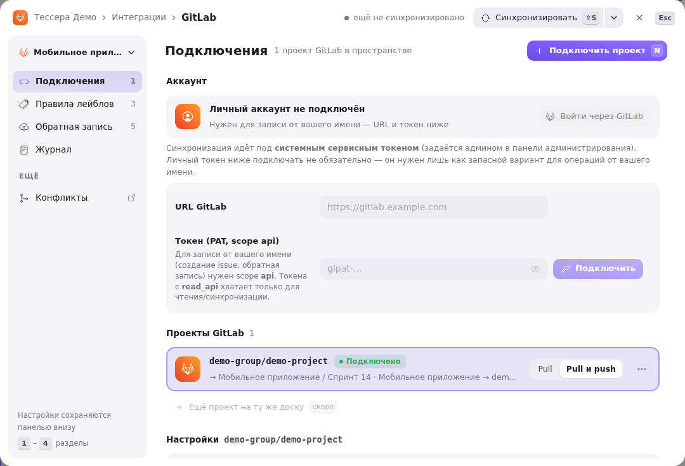
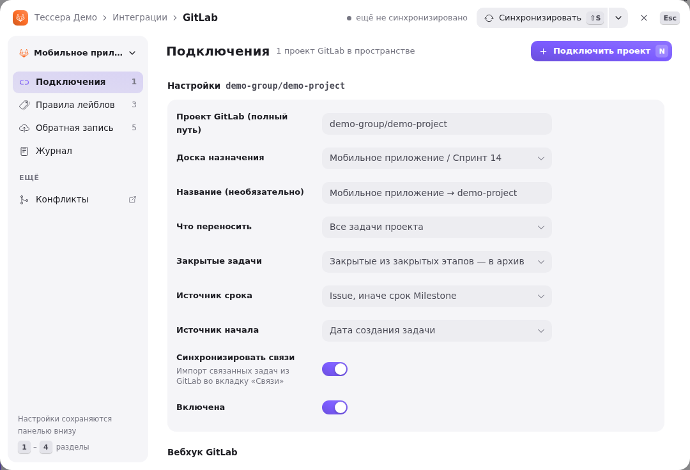

A binding ties **one GitLab project to one Tessera board**: the project's issues arrive on the board as tasks and are then kept up to date. A workspace can have several bindings — one per “project ↔ board” pair.

The window opens from the workspace menu — the workspace name at the top of the sidebar → **Integrations → GitLab**. It is a large window: on the left the sections **Connections · Label rules · Write-back · Journal** (also switched with the digits <kbd>1</kbd>–<kbd>4</kbd>) and a door to the **Conflicts** window, on the right the chosen section. The last sync's status and the **Sync** button (<kbd>⇧</kbd> <kbd>S</kbd>) are always in the window's header. Any workspace member can view it and start a sync, but only the instance administrator can change bindings.

## Account

The top section answers the question “who do we go to GitLab as”.

If the administrator set a **service token** in the [“Sign in with GitLab (OAuth)”](/help/admin-gitlab-oauth) card, the section says so: syncing runs under the system token, connecting a personal one is optional. This is the standard mode — one service account is enough for the instance.

A personal token serves as a fallback for operations on your behalf. It is connected with a pair of fields: **GitLab URL** and **Token (PAT)**. For writing — creating issues and write-back — the token needs the `api` scope; a `read_api` token is only enough for reading and syncing. A connected account is shown as a `@login` card with the instance address and is disconnected with **Disconnect** in the card's “⋯” menu — in two presses. Signing in with GitLab over OAuth and the token's expiry are marked “soon” for now.

When there are no credentials at all — neither a service token nor a personal one — the binding section shows a warning: syncing and write-back will not run. The bindings themselves are not lost meanwhile, and you can configure them ahead of time in peace.

## Bindings

The workspace's bindings are cards in the “Connections” section: the GitLab project path, the board, the state (**Connected**, **Off**, or **No access** when there are no credentials), the direction — **Pull** (from GitLab only) or **Pull and push** (with write-back) — and the time of the last pull. A click picks the binding: its fields open below, and the “Label rules” and “Write-back” sections show its settings. The binding can also be switched with the list at the top of the sections column.

The card's “⋯” menu has sync, full sync and **delete the connection** — in two presses. The confirmation warns you honestly: synced tasks stay on the board, only their link to GitLab is gone.

**Connect a project** (<kbd>N</kbd>) opens a new connection right in place: the project path, the board and a name — and the **Connect** button; nothing is created before it. Several projects on one board are marked “soon” for now.

## Binding fields

**Name** — an optional label that makes the binding easy to recognize in the switcher when there are several (for example, “Scrum board”).

**GitLab project (full path)** — a path of the form `group/project`, exactly as in the project address. For a project in a nested group — with all the segments: `department/team/project`.

**Target board** — the Tessera board the issues will go to. The “project + board” pair is unique: trying to bind a second project to the board (or the same project to a second board) returns an error that the binding already exists.

**Auto sync** (the “Sync” row of the “Write-back” section) — how often the background worker pulls changes: manually, every 5 or 15 minutes, once an hour. “Manually” does not disable the integration — it just means the sync runs only from the button.

**Full sync** (same place) — how often, instead of the ordinary (incremental) pass, a full one is done. The incremental pass sees changes but does not notice what is no longer in GitLab; the full one reconciles the whole project and catches deletions and discrepancies. The options range from “every 6 hours” to “every week” or “do not force”: in the last case a full pass happens only on the very first sync and on command from the menu.

**Due date source** — where to take the task's deadline from: from the issue itself, and if it has no due date — from the milestone (the default); from the issue only; from the milestone only; do not sync at all.

**Start date source** — the issue creation date, the milestone start, or nothing.

**What to import** — all the project's tasks or only the ones assigned to you.

**Closed issues** — what to do with closed issues:

- *“Closed in a closed milestone — to the archive”* (the default) — the board does not fill up with history, but recently closed tasks stay visible;
- *“All closed — onto the board (into ‘Done’)”* — the full picture, including long-closed ones;
- *“Only the ones closed within a period”* — adds a **“Closed no earlier than”** field with a cut-off date.

**Sync relations** — whether to import linked GitLab issues into the task's “Relations” tab.

**Enabled** — the binding's working switch. A disabled binding keeps all its settings but does not sync — handier than deleting it and setting it up again.

Under the fields is the **GitLab webhook**: the address and the secret you paste into the project's settings in GitLab, so changes arrive within seconds rather than on schedule. Turn on the **Issues** and **Comments** events in GitLab, plus **Merge request events** and **Pipeline events** for a task's [Development](/help/task-modal) block. Movement in the opposite direction, from Tessera into GitLab, is the **Write-back** section; it is off entirely by default and is [covered separately](/help/admin-gitlab-sync).

## Saving and running

A binding is saved whole, in one request, so saving in this window is explicit: as soon as something changes — in the connection, the rules or the write-back — a **Unsaved changes** bar appears at the bottom with **Discard** and **Save** (<kbd>⌘</kbd> <kbd>S</kbd>). The account, the webhook, deleting a binding and starting a sync act at once. A non-administrator gets no bar — the fields are view-only, while running a sync is still allowed.

**Sync** in the window's header runs an ordinary pass right now; the run switches the window to the “Journal” by itself, where it is visible live. The arrow next to it opens a menu:

- **Full sync** — force a full pass without waiting for the schedule;
- **Sync journal** — what exactly the last run did.

Discrepancies the sync did not resolve on its own are the **Conflicts** item at the bottom of the sections column, with a red count; it opens the resolver window on top.

The first sync of a new binding is always full and takes a noticeable while on a large project; the following ones run incrementally and finish within seconds. The progress is visible in the [Background jobs](/help/admin-jobs) window — that is also where to look for the reason if a sync fails.

## Common mistakes

- **“No GitLab credentials available”** — no service token is set and no personal one is connected. Start with the [OAuth card](/help/admin-gitlab-oauth).
- **The binding saved, but there are no tasks** — check that the “Enabled” toggle is on and that “What to import” is not narrowed to “Only the ones assigned to me” with the service account token: a service account usually has no assigned issues.
- **The error “the board or project is already bound”** — another binding already points at this board; find it in the switcher instead of creating a second one.
- **The sync runs, but the assignees are empty** — people are recognized by GitLab OAuth identity. Until a person has signed in to Tessera through GitLab at least once, there is nothing to match them against.
