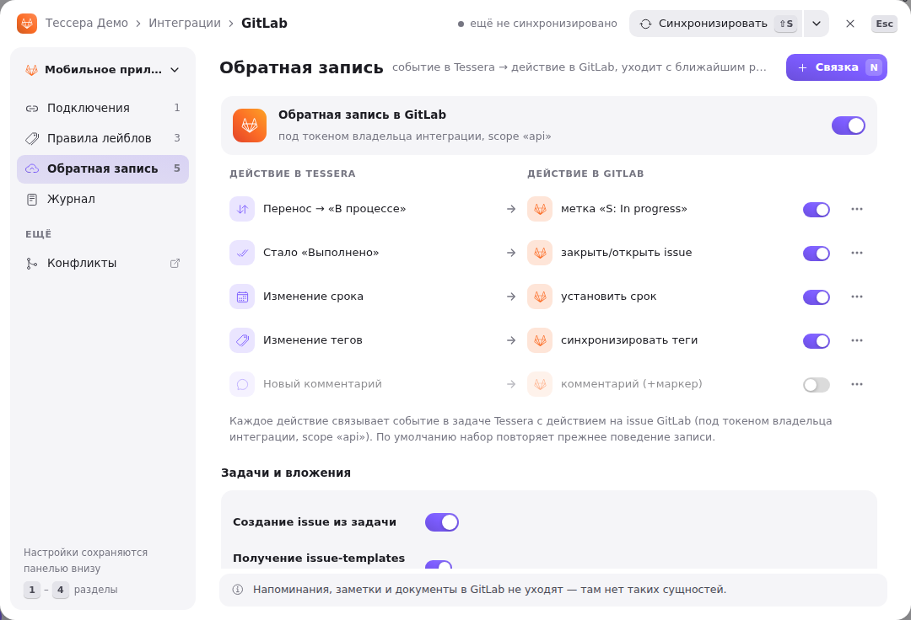
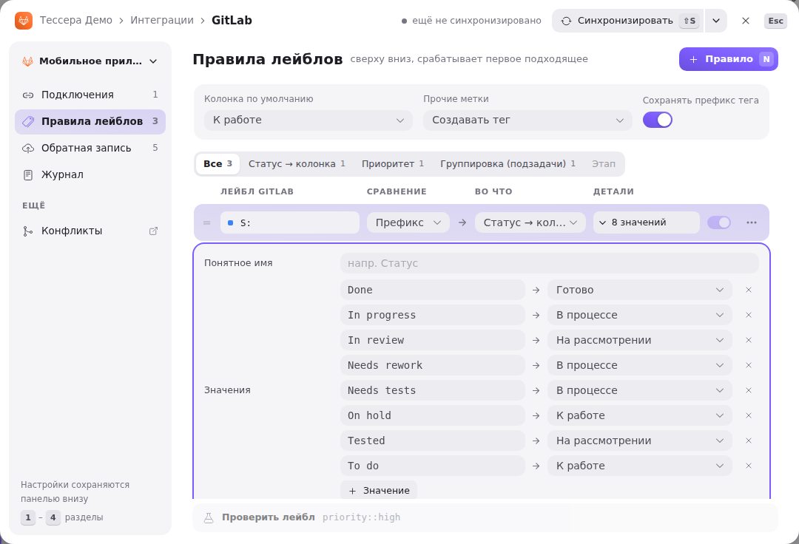

Once the [project binding](/help/admin-gitlab-project) is set up, what remains is deciding what exactly moves between Tessera and GitLab, and in which direction. There are two directions, and they are configured separately:

- **from GitLab into Tessera** — synchronization reads issues and turns their labels into a column, a priority and tags. This is governed by the **label parsing rules**;
- **from Tessera into GitLab** — task changes are pushed back onto the issue. This is **write-back**; it is off by default and is turned on one action at a time.

When both sides change the same field, the change is not overwritten but held back as a **conflict**. What exactly each run did is visible in the **sync journal**.

All the settings below are sections of the GitLab window (the workspace menu → **Integrations → GitLab**) and apply to the selected binding. Only the instance administrator can change them; they are saved from the **Unsaved changes** bar at the bottom of the window (<kbd>⌘</kbd> <kbd>S</kbd>).

## Write-back to GitLab

The window's **Write-back** section. The top card **“Write-back to GitLab”** with its toggle is the master switch: while it is off, nothing goes out to GitLab no matter how the pairs below are set. It also lets milestones linked to GitLab milestones be edited in Tessera: with write-back on, an edit of such a milestone (goals, dates, closing) goes to GitLab at once; with it off, the milestone is read-only in Tessera. The toggles about tasks and attachments are gathered in the **“Tasks and attachments”** block of the same section.

**Create an issue from a task** adds a **“Create a GitLab issue”** button to the task modal (under the “Parent” property). The issue is opened from the task's title, description and properties, after which the task counts as synced. This is a separate capability: it works even if change write-back is not configured for any field.

**Fetch issue templates from the project** pulls in templates from `.gitlab/issue_templates/*.md` — when creating an issue, you can pick a template above the description editor.

**Push subtasks into the GitLab hierarchy** creates the subtasks of a grouped task as child items of the issue. The parent is marked by the label from the **“Grouped-task label”** field (empty — `M: Сгруппированная задача` is used). The label is set here rather than as a tag: it has to be read as grouping by the parsing rules, otherwise the server rejects the “Mark as grouped” button. **“Label the parent automatically”** is off by default — otherwise the very first subtask would quietly edit labels in GitLab; instead, a hint with a button appears in the subtask list.

**Upload attachments to GitLab** copies images from the description and comments, as well as the task's files, into the GitLab project's upload store. Without this, links inside the issue stay broken — GitLab resolves them against its own address. It is turned off when you would rather not duplicate binaries: links are then replaced with a note. Note: deleting a file in Tessera does not remove the GitLab copy — GitLab has no upload-deletion API.

### Write-back actions

What exactly happens to the issue is set by **pairs** — “event in Tessera → action in GitLab” rows in the “Write-back” section (while write-back is off they are hidden). A click on a row or <kbd>Enter</kbd> opens its editor right in place; **Pair** (<kbd>N</kbd>) adds a new one; <kbd>⌫</kbd> or “⋯” → “Delete” removes a row with an undo toast, <kbd>Space</kbd> turns it off and on.

Each row is an “event in Tessera → action in GitLab” pair, with its own toggle: a rule can be silenced without deleting it. Entries go out under the integration owner's token, which needs the `api` scope.

There are ten events in Tessera: move to a column, the “Completed” flag, a priority change, a due date, assignees, an estimate, a milestone, a title or description, tags, and a new comment. Some of them have a qualifier — a specific column, a specific priority level (“Any priority” = any change), the direction of the “Completed” flag (“Became ‘Completed’” / “‘Completed’ cleared” / any change).

There are nine actions in GitLab:

| Action | What it does |
|---|---|
| **Set a label** | puts the given label on the issue. The **“Clear labels with the same prefix”** toggle removes prefix neighbors — so `S: In progress` displaces `S: To do` rather than piling up alongside it |
| **Close / reopen the issue** | closes or reopens; the “From the ‘Completed’ flag” variant takes the direction from the task itself |
| **Set the due date** | writes `due_date`. An issue has no start date, so this variant is ignored for them |
| **Set the assignees** | carries over the task's assignees. Only those who signed in to Tessera through GitLab are matched |
| **Set the estimate** | writes `timeEstimate`; it only makes sense when the board counts the estimate in time |
| **Set the milestone** | sets the milestone — if the Tessera milestone is itself linked to GitLab |
| **Update the title/description** | carries the task's text over to the issue |
| **Reconcile the tags** | brings the issue's labels into line with the task's tags |
| **Post a comment** | posts a comment; **“Add a Tessera marker”** appends a signature at the end, by which a reader in GitLab can tell where the entry came from |

Moving to a column deliberately **sets a status label and does not close the issue**: closing is a separate “Completed” event, and mixing them would mean closing the issue every time a card reached the right edge of the board.

An empty table does not mean “do nothing”: if the actions were never configured, the set is restored from the previous write-back flags when the window opens, and it is shown ready for editing.

A subtlety about tags: the “Reconcile the tags” action works only when a tag name can be turned back into the full label name — that is, with **“Keep the tag prefix”** enabled in the parsing rules. If the prefix is dropped, there is no way to restore `T: bug` from the `bug` tag — and such entries are not queued at all.

### How changes are sent

Write-back is asynchronous: the task handler only puts the change into a queue, and a background worker processes it in batches roughly every ten seconds. That is why an unreachable GitLab does not slow down work in Tessera — the entry simply waits. A failed attempt is retried with a growing pause, up to five times, after which the entry is marked failed and stays in the journal. A series of edits to the same field collapses into a single entry (the last one wins) — comments never collapse.

### On a conflict, and the schedule

Under the pairs is the **“On a conflict”** policy: “Ask me” — the conflict is held back for the resolver window (see below); “Tessera wins” and “GitLab wins” are marked “soon” for now. The **“Sync”** row sets auto sync and full sync (what they mean is in the [binding article](/help/admin-gitlab-project)), and **Now** starts a pass.

## GitLab label parsing rules

The way back: how issue labels turn into a task's state. This is the window's **Label rules** section — it is available regardless of whether write-back is on.

At the top are three shared parameters:

- **Default column** — where an issue lands if no status rule fired;
- **Other labels** — what to do with labels that matched no rule: “Create a tag” (the default) or “Ignore”;
- **Keep the tag prefix** — whether to keep the label prefix in the tag name (`T: bug`) or drop it (`bug`). Tag write-back depends on this too, see above.

Below are the rules, one per row. The pattern (the GitLab label), the match type and the action are edited right in the row, and **details** (or <kbd>Enter</kbd>) open the prefix's friendly name, the prefix toggle and the value table. Order matters — rules are read top to bottom: <kbd>⌥</kbd> <kbd>↑</kbd> / <kbd>⌥</kbd> <kbd>↓</kbd> or “⋯” → “Move up” / “Move down” move a row, <kbd>⌫</kbd> deletes it with an undo, **Rule** (<kbd>N</kbd>) adds one. Above the list is a filter by action. A label → stage rule, rule switches and counters, and “Check a label” are marked “soon” for now.

Each rule consists of a pattern, a match type and an action:

- **Prefix** — a label matches if it starts with the pattern (`S: `); the rest of the name is taken as the value;
- **Regex** — a label matches by a regular expression; the whole name is taken as the value.

There are six actions:

- **Status → column**, **Priority** and **Board (routing)** — with a mapping table of “label value → column / priority level / board”. Board routing is needed when one project's issues are spread across different boards;
- **Tag** — the label becomes a task tag (with its own prefix toggle);
- **Grouping (subtasks)** — the label marks the task as a grouped parent;
- **Ignore** — the label is dropped.

A rule of the “Prefix” type has a **friendly name** — the label under which the prefix is shown in the Tessera interface (for example, “Status” for `S: `). It is stored on the project, not on the rule, so it is visible on other tag screens too.

Parsing goes top to bottom: each label goes to the first rule it matches, and the status, priority and board are taken from the first match that fired. Values in the tables are compared case-insensitively — the label `S: In Progress` finds the row `In progress`.

Out of the box the rules are filled with the layout common to the project: `S: ` — status, `P: ` — priority, `M: ` — grouping, everything else becomes tags with the prefix kept. If a team uses a different label system, it is more sensible to rewrite the mapping tables than to rename labels in GitLab.

## Conflicts

Synchronization does not decide for you who is right. If **both you and GitLab** changed the same field since the last exchange, the entry is not sent but held back as a conflict. This is how the title and description, due date, estimate, the “Completed” state and priority behave — that is, the fields where losing someone else's edit would be noticeable.

An unresolved conflict is visible right away: an orange **“Conflict”** badge on the task card, a count next to “GitLab” in the workspace menu and a red count on the **Conflicts** item of the GitLab window's sections column.

The **Resolve conflicts** window opens on top — from the GitLab window's sections column, from the journal (“Resolve the conflict”, <kbd>C</kbd>) or from the badge on a card. On the left is the queue of tasks in conflict and how many fields each still needs; on the right the fields in a grid: **Base** (the value as of the last sync), **Tessera** and **GitLab**; for the title and description the differences are highlighted. A field changed on one side only is taken automatically and drawn quieter.

A version is picked **per field** — with a click on a cell or the keys <kbd>B</kbd> / <kbd>T</kbd> / <kbd>G</kbd> (the field — <kbd>↑</kbd> <kbd>↓</kbd>). <kbd>M</kbd> merges a text or numeric field by hand (for status and priority the choice is binary anyway). <kbd>⌘</kbd> <kbd>[</kbd> and <kbd>⌘</kbd> <kbd>]</kbd> go to the neighbouring task, **Open the task** takes you to it on the board.

**Milestones** join the queue too (marked «stage»): if the goals, name or dates of a milestone linked to a GitLab milestone were changed both in Tessera and in GitLab, the edit does not overwrite GitLab but waits for a decision here. The window opens by itself right after such an edit; **Open the stage** leads to the milestone page. A decision on a milestone is written to the GitLab milestone at once. More in [Milestones](/help/milestones).

The decisions go to GitLab in one push, so here, unlike the other windows, there is an explicit **Apply and push** button (<kbd>⌘</kbd> <kbd>↵</kbd>); while any field has no version it stays disabled. <kbd>Esc</kbd> closes the window, and the choices stay a draft until the page reloads. “Postpone” is marked “soon” for now. After applying, the base snapshot is updated so the next edit is not treated as a discrepancy again.

## Sync journal

The window's **Journal** section (<kbd>4</kbd>; a started sync opens it by itself). At the top are three tiles: the last pull, the last push and the schedule; below, the filter **All · Pull · Push · Errors**. On the left are the runs: the direction (**Pull** — reading from GitLab, **Push** — delivering write-back), the GitLab project, what triggered it (manual or auto), the outcome, the duration and the time. The dot on the right shows the state: running, success, partial, error. A run happening right now is visible live — the time counter ticks, and when it ends the row changes its status by itself, with no need to reopen the pane.

A pull run's counters read like this: `+N` — tasks created, `~N` — updated, “no changes” — the pass completed and found no discrepancies. A push run counts deliveries.

Clicking a run expands its list of actions; clicking an action shows the details on the right: which fields changed and to what, which tags, comments and assignees were touched. A long run is paged — **“Show more”** appears at the bottom of the list. A failed delivery (push only) has a **“Retry”** button (<kbd>R</kbd>) — it puts the entry back into the queue — and, when its task is in a conflict, **“Resolve the conflict”** (<kbd>C</kbd>).

## If something goes wrong

- **Changes do not go out to GitLab.** Check the master “Write-back to GitLab” toggle, then whether there is an enabled pair for the event in question. An event with no action is not queued at all, and leaves no trace of itself in the journal.
- **Tasks arrive in the wrong column.** Look at the status rule: most likely the label value is missing from the mapping table, and the default column fired.
- **Labels arrive as tags instead of a status.** No rule matched, and the label was picked up by “Other labels → Create a tag”. Most often the culprit is the prefix: the rule has `S: ` with a space, while the GitLab label is `S:In progress`.
- **Tags do not go back to GitLab.** Enable “Keep the tag prefix” — without the prefix a tag name is not turned back into a label name.
- **Assignees are not carried over either way.** People are matched by GitLab identity: until a person has signed in to Tessera through GitLab at least once, there is nothing to match them against.
- **An entry is marked failed.** Open it in the journal — the GitLab error text is there. After fixing the cause (token permissions, a deleted issue, an unreachable server) click “Retry”.
- **The “Mark as grouped” button does not work.** The grouped-task label has to fall under a rule with the “Grouping” action; otherwise Tessera would set a label it would then read back as an ordinary tag.
