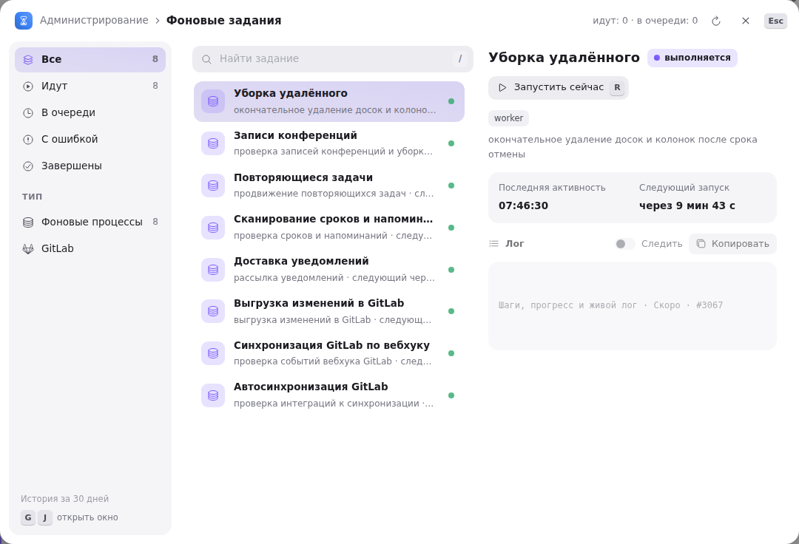

Часть работы Tessera делает сама и не на глазах у пользователя: опрашивает GitLab, выгружает туда изменения, рассылает уведомления, наступает сроки напоминаний, создаёт повторяющиеся задачи. Окно **«Фоновые задания»** показывает, что из этого сейчас выполняется, когда произойдёт в следующий раз и что закончилось ошибкой.

Открывается клавишами <kbd>G</kbd> <kbd>J</kbd>, пунктом **«Фоновые задания»** в меню «⋯» подвала боковой панели или в колонке разделов экрана [«Администрирование»](/help/admin-users) — всё это есть только у администратора экземпляра.

## Воркер и синхронизация — разные вещи

В списке два вида строк, и путать их не стоит.

**Worker** — постоянный цикл, который живёт всё время, пока работает сервер, и просыпается по своему интервалу. Он почти всегда «выполняется»: это состояние самого цикла, а не признак того, что прямо сейчас идёт тяжёлая работа. Для воркера имеет смысл строка **«Следующий запуск»** — через сколько он проснётся.

**Синхронизация** — разовый прогон с началом и концом: конкретный запуск обмена с GitLab по одной интеграции. У неё есть длительность, режим, счётчики созданного и обновлённого.

## Постоянные воркеры

Их пять, роль у каждого своя:

| Воркер                            | Интервал | Что делает                                                         |
| --------------------------------- | -------- | ------------------------------------------------------------------ |
| Автосинхронизация GitLab          | 30 с     | смотрит, каким интеграциям пора синхронизироваться, и запускает их |
| Выгрузка изменений в GitLab       | 10 с     | отправляет в GitLab накопившиеся изменения задач (обратная запись) |
| Доставка уведомлений              | 10 с     | разбирает очередь уведомлений и отправляет их по каналам           |
| Сканирование сроков и напоминаний | 60 с     | ищет наступившие сроки задач и сработавшие напоминания             |
| Повторяющиеся задачи              | 60 с     | создаёт следующее повторение по расписанию                         |

Интервалы фиксированные; настраивать их из интерфейса нельзя.

## Как читать окно

Слева — фильтры: **Все · Идут · В очереди · С ошибкой · Завершены** и по типу — **Фоновые процессы** и **GitLab**; у каждого счётчик, у ошибок — красный. Цифры <kbd>1</kbd>–<kbd>7</kbd> переключают их с клавиатуры.

Посередине — список заданий с поиском (<kbd>/</kbd>); <kbd>↑</kbd> <kbd>↓</kbd> ходят по строкам. Под именем у воркера — что он делает и когда следующий запуск, у синхронизации — режим и чем запущена. Справа в строке: «В очереди» или «Ошибка» пиллом, у идущей синхронизации — сколько она уже идёт, у завершённой — галочка со временем окончания, у живого воркера — зелёная точка. Список сам обновляется каждые несколько секунд; кнопка со стрелками в шапке окна обновляет его немедленно, там же сводка «идут · в очереди».

Справа — карточка выбранного задания: статус, для воркера — последняя активность и следующий запуск, для синхронизации — режим (**инкрементальная** или **полная**), чем запущена (**вручную** или **по расписанию**), начало, конец, длительность и счётчики **создано / обновлено**. Если задание упало, ниже будет текст ошибки на красной подложке. Шаги, прогресс и живой лог задания, а также история за 30 дней пока помечены «скоро».

## Метка «журнал»

Метка **«журнал»** у названия означает, что запись взята из сохранённого журнала синхронизаций, а не из памяти процесса: такие строки переживают перезапуск сервера. Всё остальное — живое состояние, и после перезапуска список воркеров начинается с чистого листа.

В окне показываются завершённые прогоны за последний час. Более старые из окна уходят — это витрина текущего состояния, а не полная история; историю по конкретной интеграции смотрят в журнале синхронизации в её настройках.

## Запустить и остановить

**«Запустить сейчас»** (<kbd>R</kbd>) выполняет работу воркера немедленно, не дожидаясь следующего тика. Это то, что нужно, когда изменение уже сделано, а ждать минуту не хочется — например, проверить, уходит ли уведомление. Кнопка есть только у воркеров: разовую синхронизацию конкретной интеграции запускают из её собственных настроек, а не отсюда.

**«Остановить»** (<kbd>⇧</kbd> <kbd>⌫</kbd>) появляется у выполняющегося задания, которое умеет отменяться, — сейчас это синхронизации с GitLab. Отмена не мгновенная: задание останавливается на ближайшем безопасном шаге, поэтому строка какое-то время ещё держится в состоянии «выполняется». Уже перенесённые данные при отмене не откатываются — следующий прогон просто продолжит с того места, куда дошёл предыдущий.

## Если задание завершилось ошибкой

Красная точка и текст ошибки в карточке — первое, что стоит прочитать: чаще всего там прямо назван недоступный адрес GitLab, истёкший токен или отсутствующие права. Порядок действий обычно такой:

1. прочитать текст ошибки в карточке задания;
2. проверить настройки интеграции — адрес, сервисный токен, права токена;
3. запустить работу заново («Запустить сейчас» для воркера, повторная синхронизация — из настроек интеграции) и посмотреть, повторится ли ошибка.

Одна неудачная попытка не останавливает воркер: он продолжит просыпаться по своему интервалу и попробует снова.

## Что дальше

Кто имеет доступ к этому окну и остальным админским экранам — в статье [«Пользователи экземпляра»](/help/admin-users).
