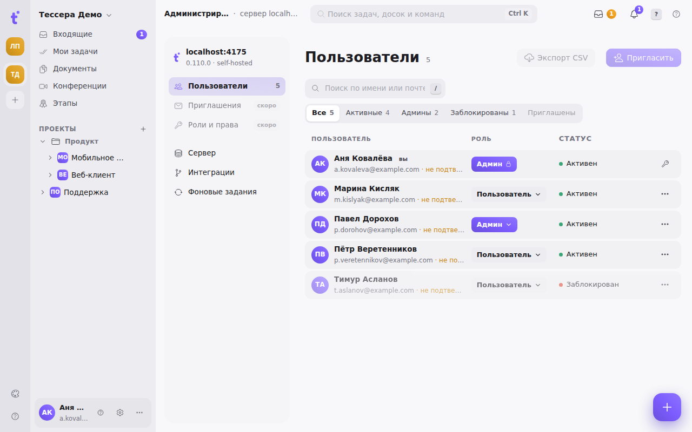

Экран **«Администрирование»** управляет учётными записями всего экземпляра Tessera: кто может войти, у кого есть права администратора, кому выдать ссылку для восстановления доступа. Это не настройки пространства — участников конкретного пространства приглашают и удаляют отдельно, а здесь речь об аккаунтах целиком.

## Кто такой администратор экземпляра

Администратором **автоматически становится первый зарегистрированный пользователь** — тот, кто поднял экземпляр. Дальше права выдаются вручную, с уже имеющегося админского аккаунта.

Администратор видит в подвале боковой панели, в меню **«⋯»**, пункт **«Администрирование»** — он и открывает этот экран. У остальных пользователей пункта нет, а прямой переход на адрес `/admin` вернёт их обратно: доступ проверяется и на сервере, поэтому «угадать ссылку» нельзя.

Права администратора экземпляра дают: этот экран, раздел **«Интеграции»** на нём (вход через GitLab), окно **«Фоновые задания»** и управление интеграцией с GitLab. Обычная работа — доски, задачи, документы — от них не зависит.

## Как устроен экран

Слева — колонка разделов: **«Пользователи»**, **«Сервер»** (адрес экземпляра и версии API и веб-клиента), **«Интеграции»** ([вход через GitLab](/help/admin-gitlab-oauth)) и **«Фоновые задания»** — последний пункт открывает [окно заданий](/help/admin-jobs). Открытый раздел записан в адресе, так что ссылку на него можно сохранить. Пункты с пометкой **«скоро»** — приглашения по всем пространствам, роли и права — ещё в работе.

## Список и поиск

Раздел **«Пользователи»** — таблица всех аккаунтов; рядом с заголовком их общее число. Поле поиска (клавиша `/`) фильтрует по имени и почте по мере ввода, переключатель рядом — **«Все»**, **«Активные»**, **«Админы»**, **«Заблокированы»**, у каждого варианта своё число.

Каждая строка — отдельная карточка: аватар, имя и почта, **роль**, **статус** и меню **«⋯»**. Ваша собственная строка помечена **«вы»**, неподтверждённая почта — пометкой **«не подтверждён»** рядом с адресом. Пометка информационная: подтверждение почты не блокирует работу, но по неподтверждённому адресу не дойдут ни письмо о восстановлении доступа, ни уведомления по почте.

С клавиатуры: `↓` из поиска переходит в таблицу, `↑` `↓` идут по строкам, `↵` открывает меню строки.

## Выдать и снять права

Роль в строке — это кнопка: **«Админ»** (в акцентном цвете) или **«Пользователь»**. Нажатие открывает меню ролей. Выдать права — один пункт, **«Администратор»**. Снять — пункт **«Пользователь»**, и он двухшаговый: первое нажатие подсвечивает его красным и называет, у кого снимаются права, второе — снимает. Неосторожный клик не должен оставить экземпляр без администратора.

Свою собственную роль изменить нельзя — в своей строке роль показана с замком, и сервер отклонит такую попытку. Так единственный администратор не сможет случайно разжаловать сам себя и закрыть себе доступ ко всем админским экранам.

## Заблокировать вход

**«Заблокировать вход»** в меню «⋯» строки — тоже двухшаговый пункт — запрещает пользователю вход. Аккаунт при этом сохраняется целиком: задачи, комментарии, авторство и упоминания остаются на месте, человек просто больше не может войти. Это штатный способ проводить увольнение или закрывать доступ подрядчику — в отличие от удаления, он ничего не ломает в истории.

Строка заблокированного аккаунта становится приглушённой, статус — **«Заблокирован»** с красной точкой, а в меню появляется **«Разблокировать вход»** — доступ возвращается одним нажатием. Свой собственный аккаунт заблокировать нельзя.

## Ссылка для восстановления доступа

Пункт **«Скопировать ссылку для сброса пароля»** в меню «⋯» (в своей строке — кнопка с ключом) создаёт **ссылку для сброса пароля** и копирует её в буфер обмена. Ссылка действует **один час**.

Это выручает, когда пользователь забыл пароль, а почта на экземпляре не настроена или письма до него не доходят: администратор передаёт ссылку любым доступным каналом. Если SMTP настроен, письмо со ссылкой дополнительно уйдёт на адрес аккаунта.

Ссылка — это, по сути, временный доступ к аккаунту, поэтому передавайте её лично и не публикуйте в общих чатах.

## Что дальше

Что происходит на экземпляре в фоне — синхронизации, доставка уведомлений, повторяющиеся задачи — показывает окно [«Фоновые задания»](/help/admin-jobs).
