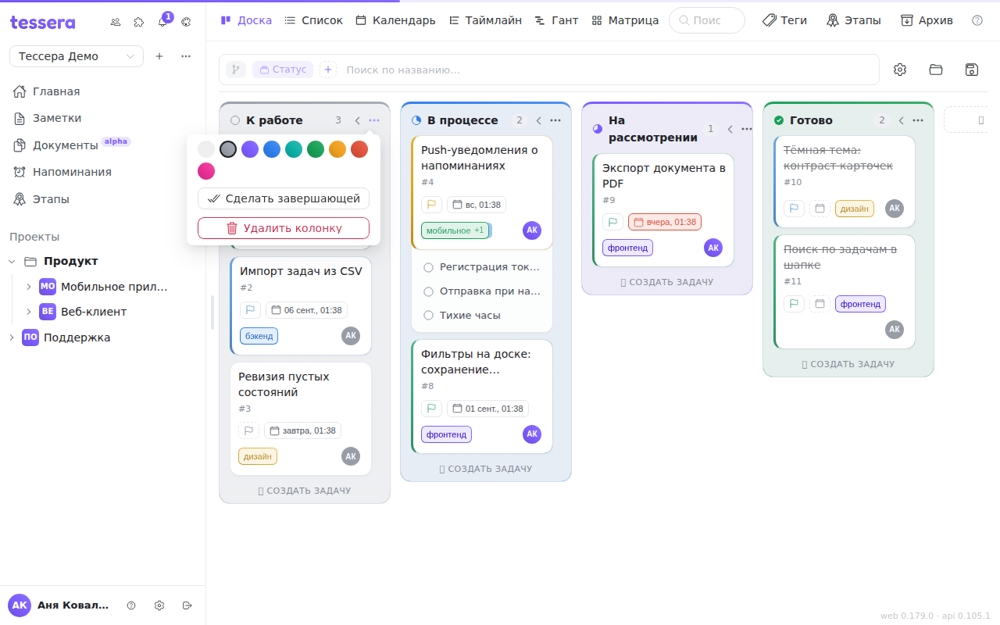

A column is a task's status. A new board starts with four columns, and the set can be changed however you like: renamed, coloured, reordered, added to and deleted.

## The four default columns

Every new board gets **“To do” → “In progress” → “In review” → “Done”**, each with its own colour. The rightmost one (“Done”) is set as the completing column right away.

These four have a property the ones you create don't: their names **follow the interface language**. Switch the language and they translate themselves. The moment you rename such a column by hand, that link is cut: from then on the column is called what you called it, in every language. This is deliberate — your name matters more than an automatic translation — but renaming it back will not restore the behaviour.

## Editing columns works in status grouping only

Everything below applies while the board is grouped **by status**. Under grouping by tags, milestones or assignee the columns aren't board columns but a way of laying tasks out: they can't be renamed or deleted, because what stands behind them are tags and milestones, not statuses. To get editing back, flip the grouping with the chip in the [board bar](/help/board-composer).

## Dragging

A column is moved **by its header**: take it by the name or by the status glyph to its left (the cursor turns into a hand) and drag it to a new place. The column order is shared by everyone who opens the board.

## Renaming with a double click

**A double click on the name** (or **F2** while the pointer is over the column) turns the header into a field right in place. Enter saves, clicking away saves too, **Esc** cancels. **Tab** saves and opens the next column's rename straight away — handy for going through a whole board. An empty name isn't saved: Enter says a name is needed, clicking away just closes the field.

The same entry lives in the column menu: **right-click the header** or press “…” → “Rename”.

## Colour

The “…” button in the header (or a right click on it) opens the column menu. Its **Colour** row holds seven circles right in the menu. The colour paints the column's top edge as a gradient strip, faintly tints its background and border, and colours the status glyph in the header. It doesn't reach the cards — a card carries its own colours (priority, tags).

## The completing column

**A task counts as done exactly when it lands in the completing column.** Not “the rightmost”, not “the one called Done”, but the one actually set as completing.

It's set in the same “…” menu with **Make it completing** (or by right-clicking the header). Pressing it again gives “Stop completing”. The completing column is marked by a solid filled status glyph in its header.

When a task enters the completing column, a completion date is stamped and a “completed” event is written to its history; move it back out and the mark is removed, with a “reopened” event written.

If no column is set explicitly, the rightmost one counts as completing. Hence the most common confusion: **a column was moved, and tasks in a different column started counting as done**. If tasks aren't being marked complete even though they visually sit “at the end”, check in the “…” menu which column offers “Stop completing” — that one is it.

Deleting the completing column doesn't break the board: the role passes to the rightmost remaining column, and the deleted column's tasks move there too, staying done. Undoing the delete brings back both the column and its role.

## Collapsing

The arrow button in the header (**Collapse the column**) folds the column into a narrow vertical strip — its tasks don't go anywhere, they just stop taking width. Clicking the strip (“Expand the column”) brings it back.

The collapsed state is remembered along with the rest of the view settings and is stored in a saved view.

There's an automatic counterpart next to it: the **Collapse empty columns** toggle in the [customize panel](/help/board-customize) folds every column without tasks by itself. Handy on boards with many columns where only two or three are busy at any moment.

## Creating and deleting

The **＋ New column** button to the right of the last column asks for a name and appends a column at the end. Inside a column there's its own **＋ New task** button: type a title and press Enter, and the task is created right in that column without opening the task window.

**New column to the right** in the column menu creates a column right after it.

Deletion lives in the column menu, under **Delete the column** (or **⌫** while the pointer is over the column). The column goes at once, with no questions, and **its tasks don't disappear** — they move to the board's first column. A message “Column … deleted · N tasks moved to …” appears at the bottom with an **Undo** button (or **⌘Z** / **Ctrl+Z**): undoing puts the column back and returns its tasks to where they stood. A board's last column can't be deleted: its tasks would have nowhere to go.

## What else the header shows

Next to the name there's always a **task counter** for the column — it counts what's visible after the filters, not the column's whole contents. Under grouping by milestone it's joined by the **sum of estimates** of the column's tasks (`Σ 12h`), in the unit chosen for the project.
