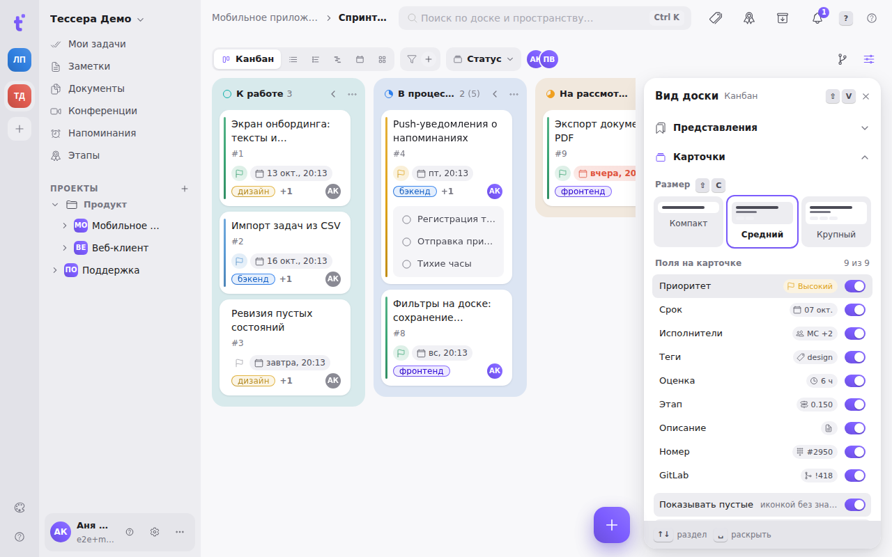

The sliders button on the right of the board bar (or the `⇧V` key, or the palette command “Board view”) opens the **Board view** panel. It docks on the right inside the board, under the bar with the chips: the board moves over and makes room, nothing is covered. The panel holds everything about the board: saved views, how the cards look, grouping and filters, columns, the board's name and icon.

The panel works in all six views — kanban, list, timeline, Gantt, calendar and matrix. Sections that have nothing to set in the current view are simply not shown: the timeline has no “Cards” and “Columns”, but it has “Scale”.

On a phone the same panel opens as a bottom sheet from the board menu “⋮” → “Board view”.

## How the sections work

Sections open one at a time, like an accordion. A closed section shows a **summary** — say, “Medium · 8 fields” for the cards — so the settings are visible without opening anything. To open several sections at once, click their headers holding `⇧`.

From the keyboard: `↑` `↓` move between section headers, space opens one, `Esc` closes the panel. The hints at the bottom of the panel say so.

## Saved views

The first section is the board's saved views: personal and shared, the “default” star, “changed”, “Update” and “Reset”. In detail — in the article [Board views](/help/board-saved-views).

## Cards

**Size** — three tiles with a mini preview: **Compact**, **Medium** (the default) and **Large**. The size changes how dense a card is and how wide the columns are. `⇧C` cycles the sizes even with the panel closed.

**Fields on the card** — a switch per field: Priority, Due date, Assignees, Tags, Estimate, Milestone, Description, Number and GitLab. Next to each switch is a preview of the pill that will appear on the card; switched-off fields have a faded preview. A switched-off field only leaves the cards: in the task it stays, and it still takes part in filters and sorting.

Below are two general switches:

- **Show empty** — draw an unset field as an icon without a value. On, you can see that a task has no due date; off, the card is cleaner.
- **Stacked** — lay the fields out in a column instead of a wrapping row. Helps in narrow columns.

A practical trick: on a board grouped by tags, switch off the “Tags” field — the tag is already in the column header.

## Scale (timeline and Gantt)

The scale — Day, Week, Month or Quarter (the same as the segments on the board bar); in Quarter the quarters are named over the months. Below it, the switches:

- **Show the task column** — the left column with the titles;
- **Shade weekends** — Saturdays and Sundays tinted;
- **“Today” line** — the vertical line and the highlight of the current day;
- **Progress inside the bar** — the line of done subtasks along the bottom of the bar;
- **Links between tasks** — Gantt only: the dependency arrows and the knob they are dragged from;
- **Undated tasks at the bottom** — the block of tasks with no dates under the chart.

The scale and the switches are remembered for the board and saved in a view; zooming with the wheel onto another scale marks the view “changed”. The section also has the “overdue / links / undated” counters and the hint about dragging a dependency.

## Matrix

Only in the Matrix view. This is where the thresholds that sort tasks into quadrants are set:

- **Urgent — due within** 1, 3, 7 or 14 days (3 by default). Overdue tasks are always urgent.
- **Important — priority from** Normal, High or Urgent (High by default).

More on the matrix itself — in the article [Views of a board](/help/board-layouts).

## Grouping and filters

These are **the same conditions as the chips on the board bar**, shown as a list: the chips are spelled out in full (“Priority: high”), the `+` button opens the same add menu, the cross removes a condition, a click on the grouping chip steps the grouping on. In detail — in the article [The board bar](/help/board-composer).

## Columns

Kanban only. **Collapse empty columns** folds columns with no tasks into narrow strips, **Expand subtasks** is the same as the branch icon on the board bar. Collapsing single columns by hand works alongside: see [Board columns](/help/board-columns).

## Board

The board's name is edited right here: Enter or a click outside the field saves it. Below are the **board's icon and colour**, the same choice as for projects and groups; the icon can be picked from the set or uploaded. The icon and colour show in the project tree on the left. The board's archive has no such section: the archive is read-only.

## What of this goes into a saved view

Everything set in the panel except the “Board” section — the view, grouping, sorting, filters, card size and fields, collapsed columns, the matrix thresholds, the timeline scale, and also the list's column widths and the calendar mode — is saved into a board view. The name, icon and colour belong to the board itself: they are the same for everybody and do not depend on the view.
