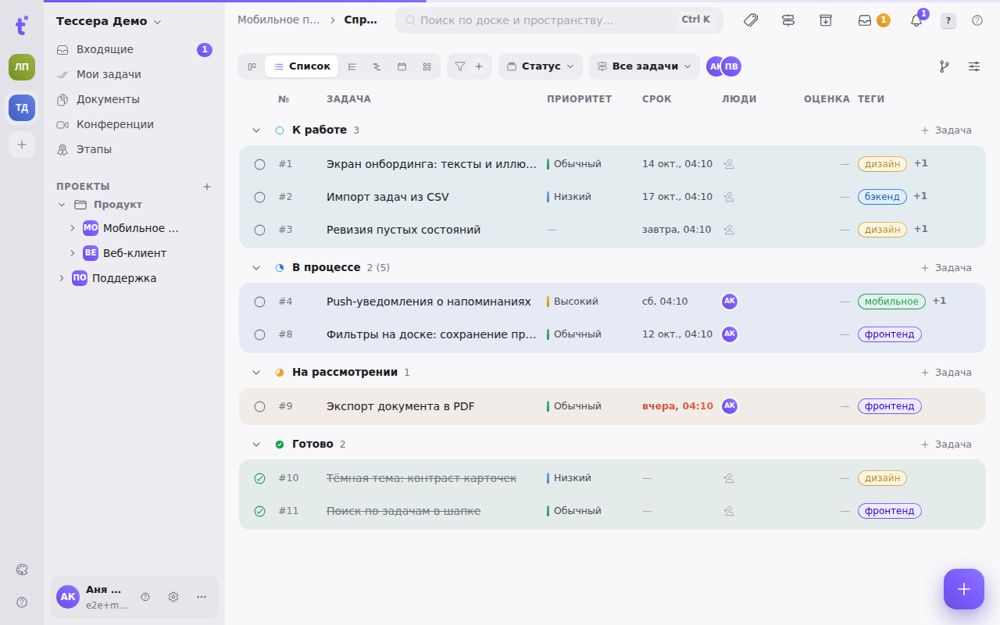
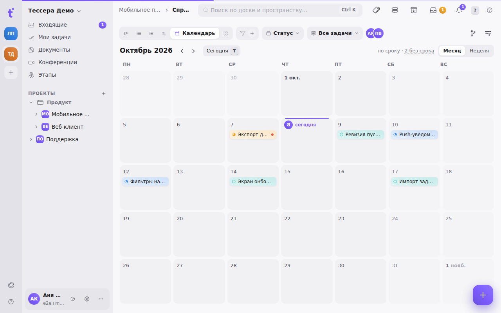
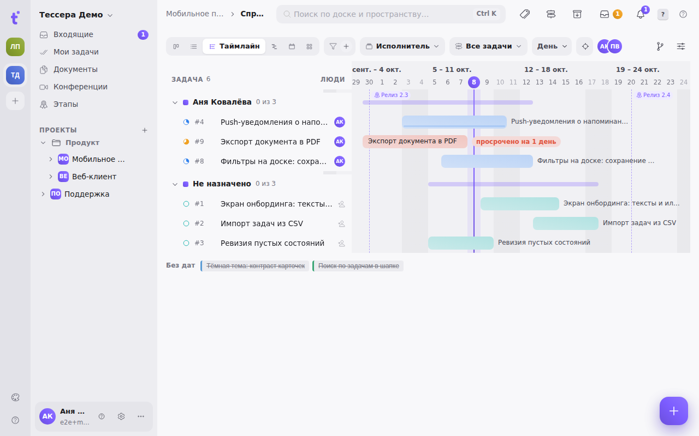
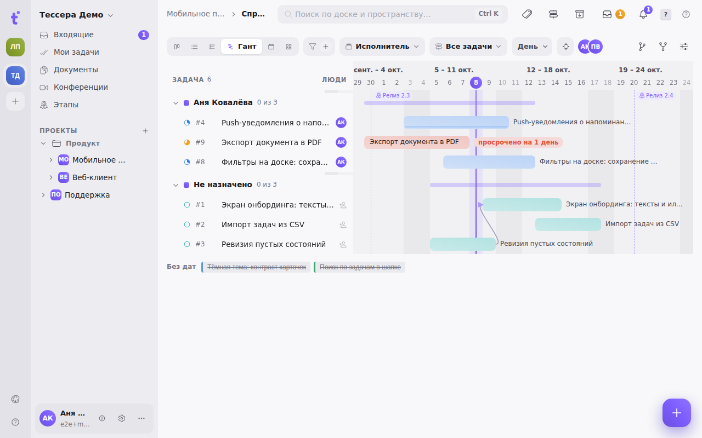
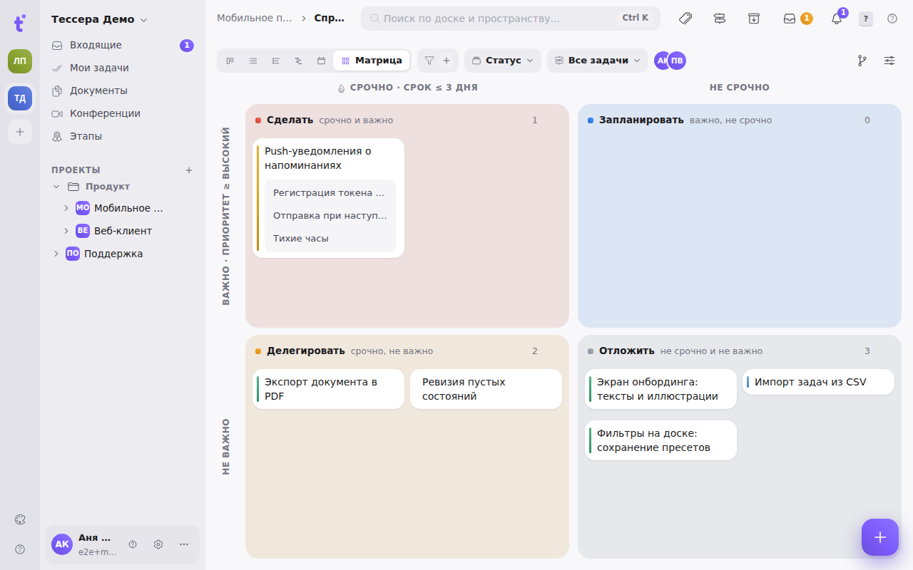

Одни и те же задачи доски можно смотреть шестью способами: Канбан, Список, Таймлайн, Гант, Календарь и Матрица. Переключатель стоит в панели доски — шесть равноправных сегментов, с клавиатуры `V`, затем `1`–`6`; когда места мало, сегменты остаются значками, а подпись есть только у выбранного. Выбранный вид запоминается для этой доски.

Важно понимать, что это **не разные доски и не копии задач**. Это один набор карточек, показанный по-разному: перенесли задачу в календаре — она переехала и на канбане.

У каждой визуализации своя память: группировка, сортировки и фильтры хранятся отдельно для каждой из них. Фильтр, поставленный на Ганте, не появится на канбане. Представление доски запоминает и вид: применили его — доска переключилась туда, где его сохранили. См. [Представления доски](/help/board-saved-views).

## Доска

Канбан — колонки и карточки, раскладка по умолчанию. Ей посвящены статьи [Доска: основы](/help/boards-and-tasks) и [Колонки доски](/help/board-columns).

## Список

Задачи строками, разложенные по **группам** — тем же, что колонки на канбане: статусы, теги или этапы, как выбрана группировка. У группы заголовок с глифом статуса, счётчиком («4 (7)» — задачи и вместе с подзадачами) и суммой оценок, под ним — подложка в тон колонки. **Клик по заголовку сворачивает группу**; свёрнутые группы у списка свои, канбан они не трогают.

В строке: номер, название, приоритет, срок, исполнители, оценка и теги. Просроченный срок подсвечен красным, завершённые задачи зачёркнуты. Кружок слева выполняет задачу (или возвращает в работу). Ширину колонок полей можно менять — потяните за край подписи колонки; двойной клик по краю возвращает ширину по умолчанию. Ширины запоминаются вместе с остальными настройками доски и сохраняются в представлении.

Клик по строке открывает задачу, правый клик — то же контекстное меню, что на карточке. Двойной клик по названию — переименование прямо в строке. «＋ Задача» в заголовке группы создаёт задачу в этой группе (`↵` оставляет поле открытым для следующей).

**С клавиатуры** список разбирается без мыши:

| Клавиша | Действие |
|---|---|
| `↑` `↓` | по строкам и заголовкам групп |
| `⇧↑` `⇧↓` | выбрать несколько строк (мышью — ⇧-клик или ⌘-клик) |
| `←` `→` | свернуть / раскрыть группу |
| `↵` | открыть задачу (на заголовке — свернуть группу) |
| `F2` | переименовать на месте |
| `E`, `P` `0`–`4`, `⌘←` `⌘→` | выполнить, приоритет, в соседнюю группу — сразу для всех выбранных |
| `P` `D` `A` `L` `S` | приоритет, срок, исполнители, теги, статус — как на доске |
| `⌘↑` `⌘↓` | поднять / опустить в колонке |
| `C` | новая задача в группе |

Порядок `⌘↑` `⌘↓` меняется только при группировке по статусу и без сортировки — тот же порядок, что у карточек на канбане. Рамка выбора и подсказка над строкой видны, только пока вы работаете с клавиатуры.

На телефоне строки выше: название, под ним номер и срок, справа исполнитель; колонки полей не показываются.

Список рисует только видимые строки, поэтому и доска на несколько сотен задач прокручивается плавно.

## Календарь

Задача стоит в клетке **своего срока** пиллом в цвете своего статуса; красная точка — срок прошёл. Сегодняшний день отмечен градиентом. Первый день недели — как в настройках («Локализация»), названия месяцев и дней — на языке интерфейса.

Два режима, переключатель справа над сеткой:

- **Месяц** — обзор. В клетке помещаются до трёх задач, остальные — «+N ещё»; клик по нему раскрывает весь день списком.
- **Неделя** — планирование: семь дней во всю высоту, все задачи дня, задачи со временем — сверху, по порядку.

Выбранный режим запоминается для доски и сохраняется в представлении.

**Перенос срока — перетаскиванием.** Потяните задачу на другой день: клетка подсветится и покажет новый срок, на отпускании он сохранится. Срок без времени так и остаётся датой, срок со временем сохраняет время, дата начала (если есть) сдвигается вместе со сроком. Задачи **без срока** собраны за ссылкой «N без срока» над сеткой: откройте список и перетащите задачу на нужный день — так ей назначается срок.

«＋» в клетке (появляется при наведении) создаёт задачу со сроком в этот день.

**С клавиатуры:** `T` — сегодня, стрелки — по дням, `⇧←` `⇧→` — месяц (в режиме «Неделя» — неделя) назад и вперёд, `C` — задача в выбранный день. `↵` переходит к задачам выбранного дня: `↑` `↓` между ними, `↵` открывает, `⇧←` `⇧→` сдвигают срок на день, `E` `P` `D` `A` `L` `S` — как на доске, `Esc` — обратно к дню.

На телефоне месяц показан точками по цвету статусов; тап по дню открывает его задачи списком.

## Таймлайн

Горизонтальная ось времени, задача — полоса от даты начала до срока. Полосы разложены по **дорожкам**, а дорожки — это та же группировка из панели доски: по статусам, тегам, этапам, исполнителю или без группировки вовсе.

Управление над диаграммой:

- **«Сегодня»** — вернуть ось к текущей дате.
- **Шкала** — «День», «Неделя», «Месяц» или «Квартал»; `−` и `+` (или колёсико с ⌘/Ctrl) меняют масштаб плавно, и шкала сама переходит на следующую.
- **Стрелка** — свернуть левую колонку с названиями задач, отдав всю ширину диаграмме.
- Справа — счётчики: сколько задач просрочено и сколько без дат.

Полосу можно **перетаскивать по оси** — так меняются даты задачи, — а также растягивать за края: левый край задаёт начало, правый — срок. Пунктирными вертикалями отмечены **сроки этапов** проекта: сразу видно, какие задачи не успевают к вехе.

Задачи без дат не выбрасываются: они собраны в блок «Без дат» рядом с диаграммой. Поставьте задаче срок или дату начала — и она появится на оси. Раскрытые подзадачи рисуются тонкими полосками внутри строки родителя.

## Гант

Гант — это таймлайн плюс **зависимости между задачами**. Ось, масштаб, перетаскивание полос и маркеры этапов работают одинаково; добавляются стрелки блокировок.

Чтобы **создать зависимость**, потяните от правого края одной полосы к другой — подсказка над диаграммой говорит то же самое. Появится стрелка «блокирует → заблокирована». В счётчиках справа добавляется число связей.

Каждая задача на Ганте занимает **свою строку** — иначе стрелке некуда было бы прийти. Поэтому Гант выглядит длиннее таймлайна на тех же данных.

Кнопка **«Авто»** в панели доски (только на Ганте) раскладывает строки **по графу зависимостей**: блокирующая задача всегда выше заблокированной. Помните: осмысленно это лишь при пустых группировке и сортировке, поэтому включение «Авто» их сбрасывает. Выключите «Авто» — и вернётесь к обычной раскладке, но снятые условия придётся выставить заново.

Подробно про сами типы связей — в статье о связях задачи.

## Матрица Эйзенхауэра

Квадрат 2×2: колонки — «Срочно» и «Не срочно», строки — «Важно» и «Не важно». Отсюда четыре квадранта:

| Квадрант | Что это значит |
|---|---|
| Сделать | срочно и важно |
| Запланировать | важно, не срочно |
| Делегировать | срочно, не важно |
| Отложить | не срочно и не важно |

**Задачи раскладываются сами.** Важной считается задача с высоким или срочным приоритетом; срочной — та, чей срок наступает в ближайшие 3 дня или уже прошёл. Оба порога меняются в панели «Вид доски», раздел «Матрица», и подписи осей их называют («Срочно · срок ≤ 3 дня»). Матрица не требует заводить ещё два поля: она читает приоритет и срок, которые у задач уже есть.

Автоматику можно переспорить: **перетащите карточку в другой квадрант**, и она там закрепится. На такой карточке появляется пометка «вручную»; клик по ней возвращает задачу на автоматическое место.

Карточки в матрице по умолчанию компактные, по две в ряд; размер меняется в панели «Вид доски», раздел «Карточки». Кнопка **«＋»** в заголовке квадранта (при наведении) создаёт задачу: она попадает в первую колонку доски и сразу закрепляется в этом квадранте.

**С клавиатуры:** стрелки ходят по карточкам и переходят в соседний квадрант, `↵` открывает, `E` `P` `D` `A` `L` `S` — как на доске, `⌘` + стрелка закрепляет карточку в квадранте в ту сторону, `⌫` возвращает закреплённую на автоматическое место, `C` — новая задача в квадранте.

**Завершённые задачи в матрицу не попадают** — это инструмент разбора того, что ещё предстоит, а не отчёт о сделанном.
