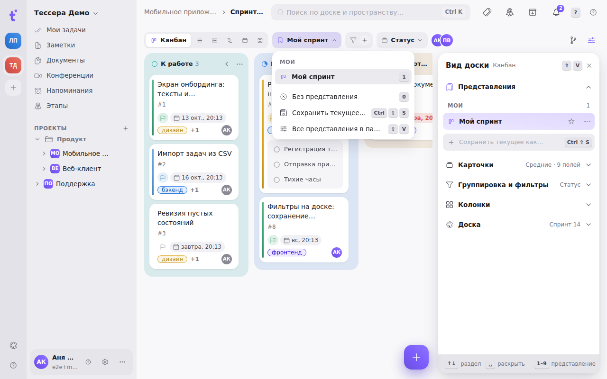

Собранная комбинация вида, группировки, сортировок, фильтров и настроек карточек — это **представление**. Его можно назвать и сохранить, чтобы возвращаться к нему одним кликом, а не собирать чипы заново.

Представления живут в первом разделе панели [«Вид доски»](/help/board-customize) (`⇧V`). Загруженное представление показывает **чип** в панели доски, сразу после переключателя видов; без представления чипа нет.

## Что сохраняется

Представление запоминает то, как вы смотрите на доску:

- вид — канбан, список, таймлайн, Гант, календарь или матрицу; применение представления переключает на него;
- группировку и префикс тегов;
- все уровни сортировки с их порядком и направлением;
- все фильтры и раскрытие подзадач;
- какие колонки свёрнуты и включено ли автосворачивание пустых;
- размер карточек, «Стопкой», «Показывать пустые» и видимость каждого поля;
- пороги матрицы;
- ширины колонок списка, режим календаря (месяц или неделя), шкалу и переключатели таймлайна и Ганта.

Не сохраняются **текст в поле поиска** (это ваш сиюминутный запрос), **этап** и **архив** — это то, где вы находитесь, а не то, как смотрите.

## Мои и общие

Раздел показывает один список из двух частей:

- **«Мои»** — ваши личные представления. Их видите только вы, зато на всех своих устройствах.
- **«Общие доски»** — их видят все участники доски. Создают и меняют их владелец и админы пространства; у остальных рядом с общим представлением замок, и вместо «Обновить» им предлагается «Сохранить как моё» — личная копия под тем же именем.

Номер строки в списке — её клавиша: в открытой панели и в меню чипа `1`–`9` применяют представление по порядку, `0` — «Без представления».

## Сохранить текущее как…

Внизу списка — строка **«Сохранить текущее как…»** (`⌘⇧S` откуда угодно на доске). Она превращается в поле прямо на месте: введите имя и нажмите Enter. Владелец и админы видят рядом с полем переключатель **«Моё / Общее»**. Имя должно быть уникальным в своём списке: два личных «Спринт» нельзя, а личный и общий — можно.

## «Изменено», «Обновить» и «Сбросить»

Как только доска начинает отличаться от загруженного представления — поменяли группировку, сняли фильтр, переключили размер карточек — на чипе и на кнопке-ползунках появляется оранжевая точка, а сверху раздела — плашка: что именно поменялось и две кнопки:

- **«Обновить»** (`⌘S`) — записать текущее состояние в представление;
- **«Сбросить»** (`⌘⌫`) — вернуть доску к тому, что в представлении сохранено.

Само по себе представление не меняется: изменения пишутся в него только по «Обновить». Если вы хотите сохранить их отдельно, нажмите `⌘⇧S` — получится новое представление, а старое останется как было.

## По умолчанию

**Звезда** у строки делает представление открывающимся по умолчанию. У личного представления это «по умолчанию для меня», у общего — «для всех на доске» (ставит владелец или админ). Ваша звезда перекрывает общую.

Представление по умолчанию применяется, когда вы открываете доску в новой сессии браузера. Внутри сессии доска помнит, где вы остановились: переходы между досками и перезагрузка страницы не сбрасывают ваши текущие настройки.

## Меню строки

У каждой строки есть меню «⋯»: **переименовать** (`F2` или двойной щелчок — имя правится прямо в строке), **обновить из текущего**, звезда **«Открывать по умолчанию»**, **сделать общим** / **сделать личным** (для владельца и админов), **выше** / **ниже** (`⌥↑` / `⌥↓`) и **удалить** (`⌫`). Удаление происходит сразу, а внизу экрана появляется тост с отменой — `⌘Z` или кнопка в тосте возвращают представление на прежнее место.

## Без представления

Пункт **«Без представления»** в меню чипа (`0`) отключает представление: доска остаётся какой была, просто перестаёт считаться, что вы в именованном представлении. Такое безымянное состояние доски запоминается для каждой доски и каждого вида, но **только на этом устройстве**. Если набор условий должен пережить смену устройства, сохраните его как представление.
