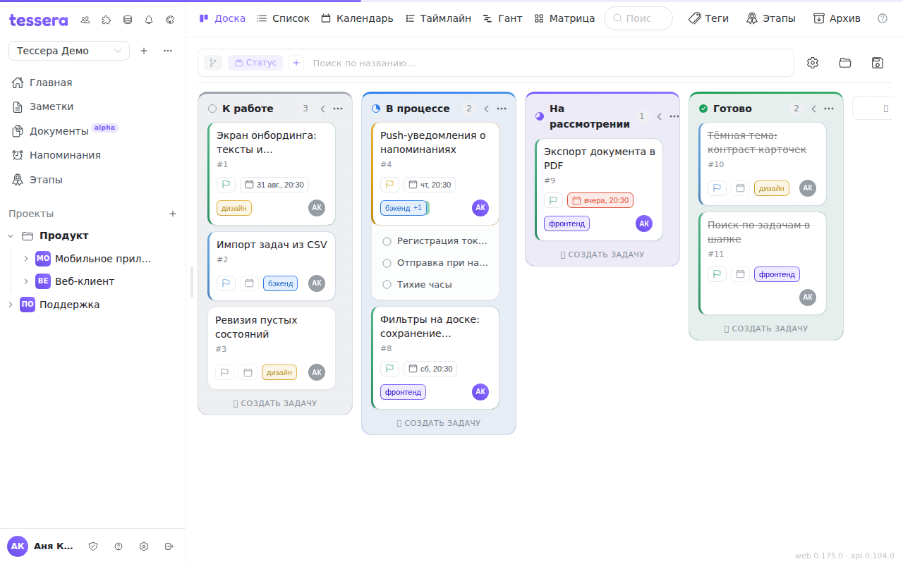
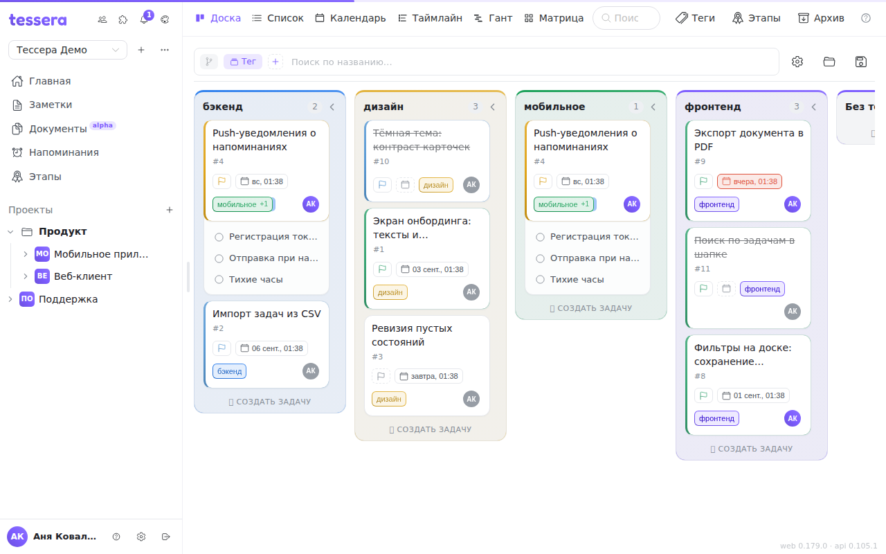
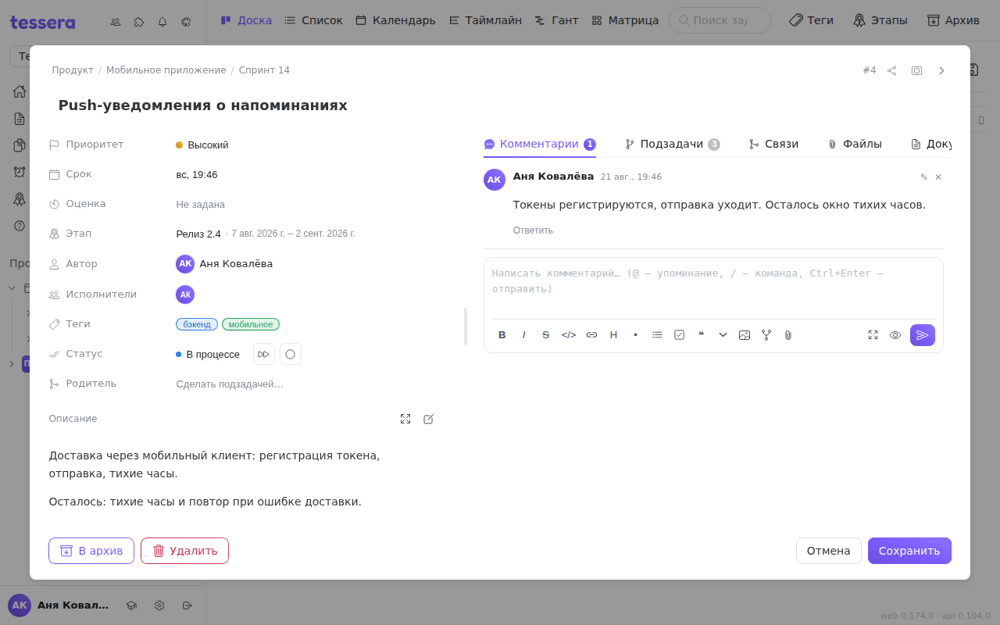

The board is the main working screen. Columns set the stages, cards are the tasks, and dragging a card with the mouse changes its state.

## What's on the screen

- **Header** — the breadcrumbs “project › board”: a click on the project opens the [«Project» window](/help/project-window), a click on the board opens the list of the project's boards for a quick jump. Next to them is the favourites star (coming soon).
- **The “⋯” button on the right of the board bar** — the board menu: «Tags», «Milestones», «Project settings», GitLab, «Archive» and [«Trash»](/help/trash). Next to it is a cascade of avatars — the people who have tasks on this board.

## Grouping by tags

A board's columns don't have to be stages. The **Board view** panel (the sliders button on the board bar, `⇧V`) has a **“Grouping and filters”** section: switch the grouping to tags and you get a board where a column is a tag, not a stage. The very same set of tasks can be viewed either as a flow through stages or as a layout by direction, team or client — without rebuilding the board.

The same place is where sorting within columns and filters are set; the chosen conditions show up as chips, and an unwanted one is removed with its cross. The fastest way to switch is the grouping chip on the board bar itself — clicking it flips “Status” to “Tag” and back.

A single task with two tags lands in two columns at once — this isn't a duplicate but one and the same card shown in both directions. Tasks with no tags gather in an “Ungrouped” column at the end.

## Views

Besides Kanban, the board can show the same tasks differently — the view switcher on the board bar:

- **List** — a flat table, handy for bulk triage.
- **Calendar** — by due dates.
- **Timeline** and **Gantt** — duration and dependencies.
- **Matrix** — a layout across two axes (for example, priority × assignee).

The combination of view, filters and sorting you've assembled can be saved as a view in the Board view panel — see [Board views](/help/board-saved-views). A saved view opens in a single click; when the board drifts away from it, the view shows “changed” and offers “Update” or “Reset”.

## Task card

The task window opens on a click on the card and contains:

- **A description** in Markdown — with a formatting toolbar, a preview mode and mentions via `@`.
- **Subtasks** — a tree of any depth; on the board they can be expanded right inside the cards (the “Expand subtasks” toggle).
- **Tags**, **assignees**, **priority** and **due date**.
- **Comments** — also Markdown, with mentions of members.

## When a task counts as done

A task is complete once it lands in the board's **completing column**. That's also when the completion date is stamped and an event is written to the log; move it back out and the mark is removed. If a task isn't counted as done even though it visually sits “at the end”, check which column is set as completing: by default it's the rightmost, but you can specify it explicitly in the board settings.

## Empty columns

To keep a long board from sprawling, the settings panel has **collapse empty columns** — they fold into narrow strips and take up no space.
