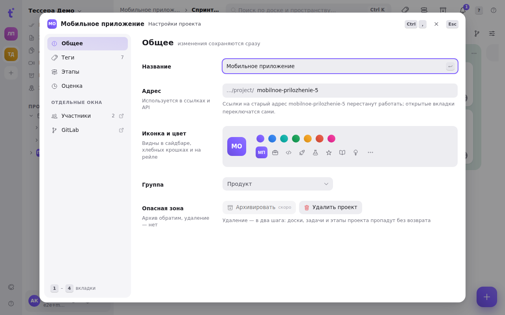

Everything a project is set up with lives in one window: its name and address, icon and colour, tags, milestones and the unit tasks are estimated in. Changes save at once — there is no «Save» button here.

## How to open it

- **Ctrl+,** (**⌘,** on a Mac) — the window of the project in front of you: the open board's or the milestone page's. Press it again to close.
- The project menu in the tree on the left → **«Project settings»**, or **«Milestones…»** to land on the milestones tab.
- The **«Tags»** and **«Milestones»** buttons in the board header (on a phone — in the board's three-dot menu).
- The command palette (**Ctrl+K**) → «The «Project» window of the current project».
- **«Manage tags…»** in a task's tag picker — the window opens on «Tags», filtered by what you had typed.

Switch tabs with the digits **1–4** or a click. **Esc** first closes whatever is open inside (a row menu, the colour palette, a selection) and only then the window itself — focus returns to where you opened it from. On a phone the window fills the screen and the tabs run along the top.

At the bottom left are links to the workspace windows that also concern the project: **«Members»** and **«GitLab»**. They open in place of the project window.

## General

- **Name** saves on **Enter** or when the field loses focus. **Esc** puts the old one back.
- **Address** — the `…/project/<address>` part of a link. The workspace owner and admins can change it. Links with the old address stop opening — the note under the field says so.
- **Icon and colour** — the same ones the sidebar, breadcrumbs and the rail show.
- **Group** — which project group it sits in in the tree.
- **Danger zone.** «Archive» is not available yet. **«Delete project»** takes two steps: the first press asks «Delete for good?», the second deletes it with all its boards, tasks and milestones.

## Tags

The project's tag table, grouped by prefix; see [Tags, prefixes and how to manage them](/help/tags).

## Milestones

The project's milestones with their dates, state, progress and GitLab number. A new milestone — the **«+ Milestone»** button or **N**: an empty row appears, **Tab** moves to the dates, **Enter** creates it. A click on a row opens the [milestone page](/help/milestones). More in [Milestones](/help/milestones).

## Estimation

The unit the project's tasks are estimated in, and the values of the estimate picker:

- **Hours** — time; next to it, hours in a working day and days in a week (they turn «3d» into hours).
- **Story points** — a Fibonacci or a linear scale.
- **T-shirt size** — XS…XXL.
- **Custom unit** — a number with your own name for it.

The **«Inherit»** switch keeps the project on the workspace's setting. **Scale** — the quick values of a task's estimate picker: **+** adds one (typed in the project's unit, e.g. `3h`), the cross on a value removes it, «Back to the default values» returns to the built-in set.

## Keys

| Key | What it does |
|---|---|
| Ctrl+, | The «Project» window of the current project |
| 1–4 | Tabs: General · Tags · Milestones · Estimation |
| Esc | Close what is open inside, then the window |
