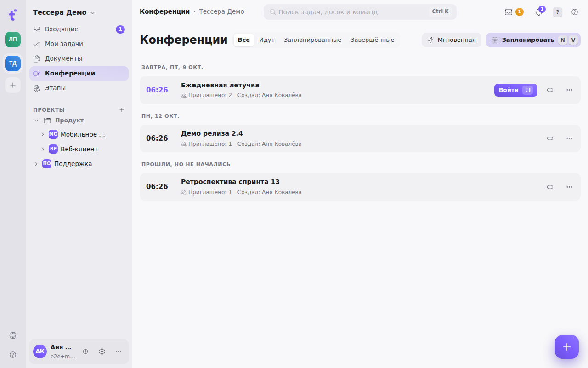
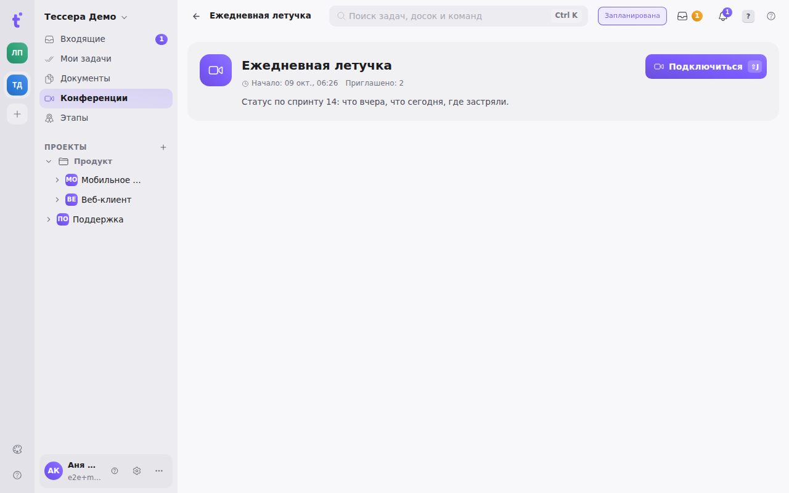

Раздел **«Конференции»** — аудио- и видеозвонки внутри Тессеры: ежедневные летучки, разбор задачи, демо. Звонок не уводит из трекера — конференцию можно привязать к задаче, а обсуждение остаётся в чате комнаты рядом с работой, а не в стороннем мессенджере. Раздел доступен и в браузере, и в мобильном приложении (на телефоне часть панелей — чат и участники — открывается снизу листами).

## Список конференций

Слева в боковой панели — пункт **«Конференции»**. Наверху списка — звонок, который **идёт прямо сейчас**: отдельная карточка с меткой «идёт · N мин» и кнопкой **«Присоединиться»**. Ниже — запланированные, по дням: **«Сегодня»**, **«Завтра»** и дальше; у ближайшей встречи время подсвечено и есть кнопка **«Войти»**. Встречи без времени, запланированные на прошедший день, но так и не начавшиеся, и завершённые — отдельными группами в конце. Сегменты над списком — **Все · Идут · Запланированные · Завершённые**.

Под временем встречи — её **длительность**, в строке — **повтор** («По будням», «Каждые 2 недели») и **этап**, к которому она привязана; по пиллу этапа открывается страница этапа. Повторяющаяся встреча стоит в списке в день **ближайшего раза**: стендап «по будням в 17:30» в пятницу вечером уже числится на понедельник.

У строки справа — кнопка ссылки (скопировать адрес встречи, чтобы отправить его в чат) и меню **«⋯»**. **«Изменить»** в меню открывает ту же форму, что и «Запланировать», — так меняют время, длительность, повтор или этап (доступно автору встречи и владельцу или админу пространства). Удаление — последний пункт меню и двухшаговый: первое нажатие взводит его, второе удаляет; удаление необратимо, вместе со встречей уходят её чат и записи.

**«Запланировать»** (клавиши <kbd>N</kbd> затем <kbd>V</kbd>) открывает форму рядом с кнопкой: название, время начала и **длительность** (по умолчанию 30 минут), описание и срок хранения записей. Внизу формы — две строки-меню: **«К этапу»** (привязать встречу к открытому этапу пространства — планирование спринта, ретро) и **повтор**: не повторять, каждый день, по будням, каждую неделю, каждые 2 недели, каждый месяц. Повтор доступен, когда выбрано время начала: он отсчитывается от него и держит время по часам вашего пояса — после перевода часов встреча «в 11:00» остаётся в 11:00. Время начала — ориентир для участников, а не замок: конференцию можно открыть и раньше. **«Мгновенная»** (<kbd>N</kbd> затем <kbd>J</kbd>) создаёт встречу без времени и сразу заводит вас в неё — когда созвониться нужно прямо сейчас. Клавиша <kbd>⇧</kbd> <kbd>J</kbd> на этой странице заводит в идущий звонок, а если такого нет — в ближайший запланированный.

Конференция **не одноразовая**. Когда последний участник вышел, она возвращается в «Запланированные» и в неё можно зайти снова — одну и ту же комнату удобно держать под постоянную летучку. Необратимо только удаление.

## В комнате

Открытая конференция сначала показывает **лобби** — карточку встречи: название, время и длительность, повтор, этап, кто приглашён, описание. В самом звонке над плитками написано, сколько участников, и — если встреча привязана к этапу — **«привязано к [этап]»** со ссылкой на его страницу. Кнопка **«Подключиться»** (<kbd>⇧</kbd> <kbd>J</kbd>) заводит устройства и ставит вас в звонок. В шапке приложения в это время — стрелка назад к списку, название встречи и, пока звонок идёт, сколько он уже длится; у ведущего справа — **«Завершить»**.

Браузер спросит разрешение на микрофон и камеру — без него звонок не состоится. Разрешение выдаётся сайту один раз; если вы случайно отказали, вернуть доступ можно в настройках сайта в адресной строке браузера.

Звонок занимает всю рабочую область. Раскладка переключается над плитками: **сеткой** — все участники равными плитками, или **«говорящий крупно»** — большая плитка следует за говорящим, остальные — полосой под ней; выбор запоминается. Во время демонстрации экрана сцену всегда занимает показ. В тишине на сцене остаётся тот, кто говорил последним, — плитки не «прыгают» на каждый вздох. Плитка без видео окрашена в тон участника, у говорящего — светящееся кольцо, у поднявшего руку — жёлтый значок в углу.

**Панель кнопок внизу:**

- **микрофон** (<kbd>Ctrl</kbd>/<kbd>⌘</kbd> + <kbd>D</kbd>) — включить и выключить. Кнопка заполняется по уровню вашего голоса: это самопроверка громкости, по ней видно, что вас слышно, ещё до того, как кто-то об этом скажет;
- **камера** (<kbd>Ctrl</kbd>/<kbd>⌘</kbd> + <kbd>E</kbd>) — включить и выключить видео;
- **демонстрация экрана** — см. ниже;
- **запись** — у ведущего и модератора, см. «Запись»;
- **реакции** (улыбка) — ряд эмодзи: 👍 👏 😂 🎉 ❤️ 🤔. Реакция всплывает над сценой у всех участников с вашим именем и через несколько секунд тает; она нигде не сохраняется — опоздавший её не увидит;
- **поднять руку** — заметная отметка на плитке, чтобы не перебивать говорящего;
- **выбор устройств** — какой микрофон, какая камера, какой динамик;
- **участники** и **чат** — открывают правую панель на нужной вкладке (повторное нажатие её прячет);
- **«Выйти»** (<kbd>Ctrl</kbd>/<kbd>⌘</kbd> + <kbd>⇧</kbd> + <kbd>H</kbd>).

**Полный экран** — кнопка в углу сцены; особенно нужен, когда смотрите чужой показ экрана.

На плитке участника появляется **значок связи**, когда канал у него плохой: прежде чем переспрашивать «вас рвёт?», видно, у кого именно проблема.

## Демонстрация экрана

Показ экрана идёт **в порядке очереди**, и очередь ведёт сервер, а не браузер: двое не могут начать показ одновременно и перебить друг друга. Если экран уже показывают, кнопка ставит вас в очередь и подписывает ваше место в ней; когда очередь дойдёт, комната сообщит, что можно начинать.

У показывающего картинка всегда чётче, чем у остальных, и это не поломка: он видит **свой сырой захват**, а остальные — сжатый поток, который прошёл через сервер. Показ публикуется с высоким разрешением и приоритетом резкости, поэтому под нагрузкой у зрителей просядет плавность, а не читаемость текста.

## Участники, чат и приглашения

Справа — панель с двумя вкладками: **«В комнате»** и **«Чат»**. Её можно спрятать кнопкой над плитками — сцена займёт всю ширину; выбор запоминается.

**«В комнате»** — кто сейчас в звонке, и отдельным списком **«Приглашены»** — те, кого позвали, но кто ещё не пришёл. Кнопка **«Пригласить»** (человечек с плюсом) здесь же, у вкладок: приглашённый получает уведомление со ссылкой прямо в конференцию.

Громкость каждого участника регулируется **у вас** и только у вас — это не влияет на то, как его слышат остальные.

**«Чат»** — переписка этой конференции: ссылки, которыми делятся на ходу, и вложения. Картинку можно открыть крупно, **не выходя из звонка**. История чата остаётся с конференцией, поэтому к сказанному можно вернуться после.

В поле чата работают две подсказки — «Сообщение · / задача · @ человек»:

- **«/» — задача прямо из встречи.** Наберите <kbd>/</kbd>, выберите **«/задача»** и допишите название: над полем появится строка **«Задача в [доска]»**, а <kbd>↵</kbd> создаст задачу в колонке «К работе» этой доски. По умолчанию выбрана доска задачи, к которой привязана встреча, или доска проекта её этапа — её можно сменить. Если встреча привязана к этапу, а доска — из того же проекта, задача сразу попадает в этот этап. В чате остаётся строка «Мария создал(а) задачу #2978 …»; по ней задача открывается на доске, а звонок продолжается в мини-окне.
- **«@» — упомянуть человека.** После <kbd>@</kbd> появится список участников пространства (<kbd>↑</kbd> <kbd>↓</kbd> и <kbd>↵</kbd>); имя в сообщении выделится, а упомянутому придёт уведомление «упомянул(а) вас в чате встречи» — по нему он попадёт прямо в звонок.

## Ведущий и модерация

Ведущий — **создатель конференции**. Его нельзя исключить из звонка, и у него приоритет в очереди на показ экрана.

Модерировать — **исключить** участника или **заглушить его для всех** — может ведущий, а также владелец и админ пространства. Админ при этом отображается обычным участником: он модерирует, но не занимает роль ведущего и сам может быть исключён.

Все проверки прав делаются **на сервере**, поэтому «заглушить для всех» — это именно принуждение, а не вежливая просьба к чужому браузеру.

## Свёрнутый режим

Из конференции можно уйти в задачи или документы, **не выходя из звонка**: кнопка «Свернуть» над плитками или <kbd>Ctrl</kbd>/<kbd>⌘</kbd> + <kbd>⇧</kbd> + <kbd>M</kbd> возвращает на экран, откуда вы пришли, а звонок продолжается в плавающем окошке.

У окошка три части. Шапка — название встречи и сколько вы уже в звонке, за неё окно перетаскивается; кнопка в шапке (или та же <kbd>Ctrl</kbd>/<kbd>⌘</kbd> + <kbd>⇧</kbd> + <kbd>M</kbd>) разворачивает звонок обратно. Посередине — две плитки: говорящий (или показ экрана) и следующий участник. Внизу — микрофон, камера, рука, сколько ещё людей в звонке и **«Выйти»**. Отпущенное рядом с краем экрана окно прилипает к нему; размер меняется за любой край. Положение и размер запоминаются. Клавиши микрофона, камеры и выхода работают и в свёрнутом режиме.

Свёрнутый звонок **переживает перезагрузку страницы**: активная конференция запоминается, и после обновления клиент сам возвращается в неё. Само соединение при этом пересобирается заново — секундная пауза в звуке здесь нормальна.

Уйти из звонка можно только кнопкой **«Выйти»** (в комнате или в мини-окне) или закрыв вкладку. Переход в другой раздел звонок не обрывает — и других участников это не вводит в заблуждение: если вкладка закрылась, вы пропадёте из списка сами.

## Запись

Разговор можно записать целиком — одним видеофайлом со всеми участниками и показом экрана. Пишет **сервер**, а не ваш браузер: качество записи не зависит от вашего канала, а вкладку можно закрыть.

Включает и останавливает запись **ведущий или модератор** — кнопкой на панели внизу комнаты. Пока идёт запись, **красную метку со временем записи видят все участники** — и в комнате, и в свёрнутом окне: незаметно записать разговор нельзя, и это специально.

Готовые записи лежат списком **под карточкой встречи**: скачать, посмотреть размер и длительность. Файл появляется в списке через несколько секунд после остановки — столько занимает сборка видео.

**Срок хранения выбирается заранее**, при планировании конференции: по умолчанию запись живёт 30 дней, после чего удаляется сама. Это решается до встречи, а не после — чтобы не выбирать судьбу файла, глядя на таймер. Ноль означает «хранить бессрочно». Срок можно поменять и позже, в настройках конференции, но подействует он только на будущие записи: у готовой записи дата удаления проставлена в момент её завершения.

Запись — **необязательная возможность экземпляра**: администратор включает её отдельно. Если она не включена, кнопка ответит ошибкой — это вопрос к администратору, а не сбой у вас.

## Что стоит знать

- Конференции требуют **защищённого соединения** (`https://`). По незащищённому адресу браузер не отдаёт микрофон и камеру вовсе, и комната честно об этом скажет вместо того, чтобы молча не работать.
- Если администратор не настроил медиасервер, вход в звонок вернёт ошибку — это вопрос к администратору экземпляра, а не сбой на вашей стороне.
- Запись **не заменяет протокол**: расшифровки и автоконспекта пока нет (у записи они видны с пометкой «Скоро» — для них нужен внешний сервис распознавания речи), поэтому решения по ходу разговора по-прежнему стоит класть в чат конференции — например, сразу задачей через «/задача» — или в описание привязанной задачи.
