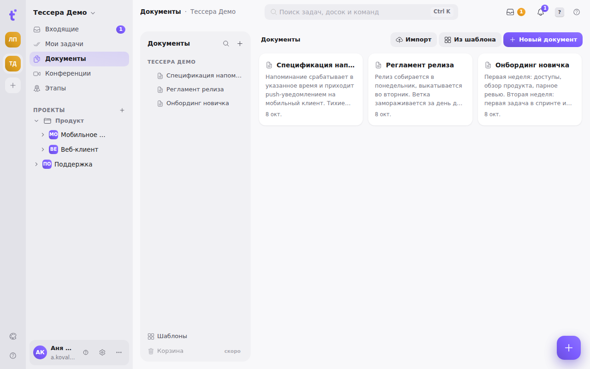
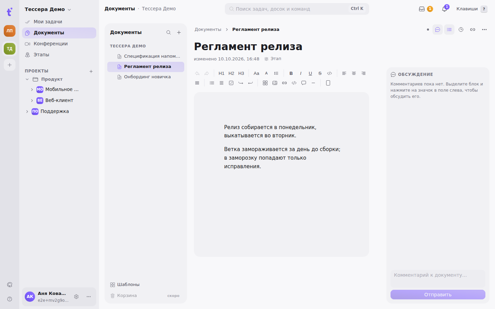
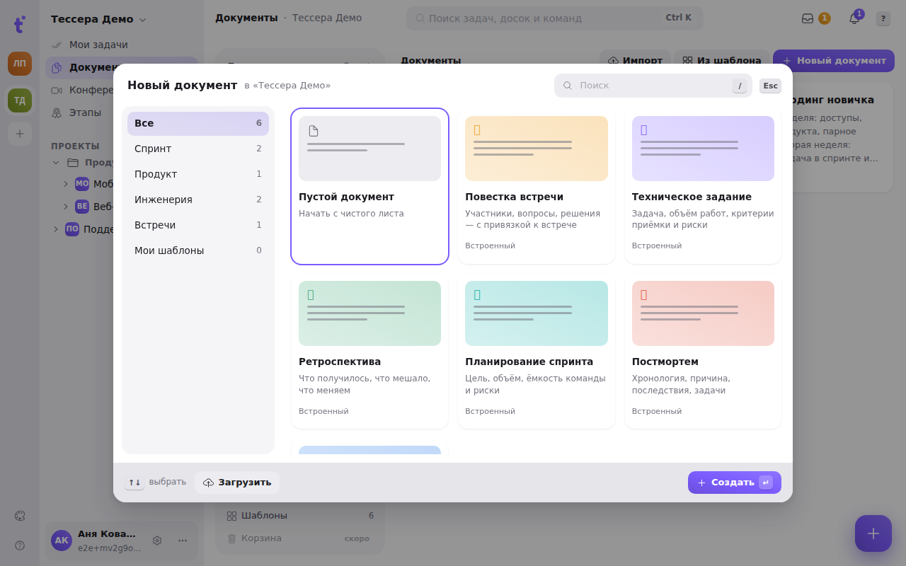

**Documents** is a collaborative editor for everything that outgrows a task description: requirements, meeting minutes, policies, how-tos. Unlike a task description, a document stands on its own — it has versions, a table of contents, per-paragraph discussion and an approval route. The section is young and still developing — details do change over time.

The section opens from **Documents** in the sidebar or with `G` then `D`.

## The document tree

On the left is the workspace's **document tree**, on the right — the document cards or the open document. A document can have **nested documents**: such a document has an arrow in the tree that folds and unfolds its branch, and a folded branch shows the number of nested documents on the right. That makes the section behave like a small wiki rather than a flat folder of files. The tree remembers which branches are open; the path to the open document is always unfolded.

The tree's head has a **search** by title (it shows the matches together with their parents) and **+** — a new document. At the bottom are **Templates** (opens the template gallery) and **Trash** — the deleted documents (more below).

From the keyboard in the tree: `↑` `↓` move between rows, `→` unfolds a branch or steps into its first child, `←` folds it or steps back to the parent, `↵` opens the document.

On a narrow screen the tree gives way to the text: the button on the left of the document's head hides it and slides it out over the text. A phone has no tree — the cards are the way in there.

## The document's head

Above an open document is its **path** (“Documents › section › document”; the first item takes you back to the cards), and on the right — who else is in the document, the save state and the tools: **discussion**, **table of contents**, **version history**, **links and approval** and the **“⋯”** menu.

The “⋯” menu holds **Nested document** (creates a child), **Show nested (N)** (opens the branch as cards), **Save as template**, **export** in the available formats and **Delete document**. The document goes to the trash at once — with its nested documents — and a message with an **Undo** button (<kbd>Ctrl</kbd> <kbd>Z</kbd>) appears at the bottom.

### The documents trash

**Trash** at the bottom of the tree (on a phone — the trash button in the section's head) lists the documents deleted in the last **30 days**: who deleted each, when, how many days it has left and how many nested documents went with it. **Restore** puts a document back where it was in the tree (at the root, if its parent is in the trash too), **Delete forever** — in two presses — erases it with its images. After 30 days the trash deletes documents by itself.

While a document is in the trash it is out of the tree, search and the tasks' Documents section, but **its links to tasks are kept** — they come back with the document.

## The editor

Text is written in a block editor — every paragraph, heading, list and table is a block of its own.

**The toolbar** above the document: undo and redo (Ctrl+Z / Ctrl+Shift+Z), heading levels, bold (Ctrl+B), italic (Ctrl+I), underline (Ctrl+U), strikethrough, monospace; lists — bulleted, numbered and a **task list** with checkboxes; increase and decrease indent; a 3×3 table with a header row; image, link, code block, quote, divider; align left, centre, right and justify. To the right sit three pickers: **font** (system, serif, monospace), **size** and **line height**. The «default» value in each of them drops the manual setting and hands the styling back to the theme.

**The `/` key opens the insert menu** right in the text — the same thing without a trip to the toolbar, grouped into Text, Lists, Insert and Upload: paragraph, three heading levels, quote, lists, table, divider, code block, image and PDF.

**The handle to the left of a block** (it appears on hover) offers three actions: **insert a block below**, **discuss the block** and **drag the block** somewhere else.

A link does not have to point outwards: besides `https://…`, the address field lets you pick **a section of this document**, which produces an internal link to that heading.

## Table of contents

**Table of contents** opens a pane built from the document's headings; clicking a line scrolls to that section. While there are no headings, the pane says so outright — the contents are not assembled by hand and need no special markup.

## Saving and working together

The document saves itself. The state is in the document's head, a dot and a caption: **Saving…**, **Unsaved changes** or **All changes saved** (in a tight head only the dot stays, the caption moves to its tooltip).

While several people have the document open, the document's head shows who is **editing** and who is **viewing**. A block a colleague is editing right now is locked for everyone else — typing into it answers with «_name_ is editing this block». Work in the neighbouring paragraph is unaffected.

If the document was changed elsewhere anyway (in another tab, say), you get the warning **«The document was changed elsewhere — your latest edits were not saved»** and a **Load the current version** button. Nobody's text is overwritten silently.

## Discussions

Comments in a document are **anchored to a block** rather than piling up in one list. Select a block and click the icon in the left gutter (**Discuss the block**) — the thread opens in the discussion pane beside the paragraph. A comment can also be left **on the whole document**; those threads are collected under «On the document».

A thread can be marked **resolved** and later **reopened**. The anchor can be dropped with **Unpin** — the thread stays, it just stops holding on to a paragraph. If the block with a thread is deleted, the thread does not disappear: it moves to the **Block deleted** section, where it stays readable.

Deleting a root comment warns how many replies go with it.

## Version history

**Version history** opens the list of revisions. A version is taken with **Save version**; you can attach a label to it — «approved wording», for instance — so you don't have to hunt for the right one by date later.

The selected version is shown as a **comparison against the current state**: how many blocks were added, removed, changed and moved, with a marker on each. If there are no differences, it says so — «The versions are identical».

**Restore** takes the document back to the chosen revision. The current state is **not lost — it goes into the history itself**, so the rollback is reversible.

## Task links and approval

**Links and approval** opens a pane with two halves.

**Links.** A document is linked to tasks either whole (**Link a task**) or **by fragment**: a selected block is linked separately (**Link the block to a task**), and the list labels such a link accordingly — «document fragment». Tasks are searched by number or title. The link is visible from both sides and is removed with **Remove**; the task side of it is covered in [Task documents](/help/task-documents).

**Approval.** **Send for approval** opens a route: a title (what is being approved), the list of approvers and the mode — **Sequentially** (the next person sees the request once the previous one has signed) or **In parallel** (everyone is asked at once). While a route is open, a second one cannot be started.

An approver **signs** or **rejects**, optionally with a comment. The route line shows the progress — «_signed_ of _total_» — and each participant is marked as waiting, signed or rejected. A route can be **withdrawn**; signatures already given stay in the record.

Finished routes are collected under **Approval records** with their status (pending, approved, rejected, withdrawn) and a caption of «revision N · author · date»: **a record is bound to a specific revision**, so later edits cannot pass themselves off as approved text.

## Import

**Import** accepts `.docx`, `.doc`, `.odt`, `.rtf`, `.fodt`, `.html`, `.txt`, and also `.pdf`, `.md` and `.json` (Tessera's own export). The limit is **20 MB per file**.

Formatting comes across: text colours and sizes, horizontal rules, code blocks, table fills and borders. Colours from Word stay readable in the dark theme too. If some images could not be brought over, the app says so in the notification and names the count instead of pretending everything went smoothly.

Office formats are converted by a separate service. If it is not deployed, the button says so and leaves what works without it: **PDF, Markdown and JSON**. PDF is never converted — it is stored as a file and opened by the built-in viewer: page navigation, zoom in and out, download. No need to switch to another program.

## Export

Export is in the “⋯” menu of the document's head, under **Export document**: PDF, **Word (.docx)**, **OpenDocument (.odt)** and **HTML**. HTML is rendered by the server itself and is always available; the other three need the same conversion service as import — without it, only HTML remains in the list.

Unsaved edits are written out before the export runs, so the file always matches what is on screen rather than the state of a second ago.

## Templates

**From a template** (or Templates at the bottom of the tree) opens the **New document** window: sources on the left — **All**, **Built-in**, **My templates** — and cards with previews on the right. The first card is **Blank document**. A click selects a card, a double click or **Create ↵** creates the document, the arrows move the selection, `/` searches. Template categories are marked “soon” for now. Three are built in: **meeting minutes** (attendees, agenda, decisions, follow-up tasks), **a specification** (statement, scope, acceptance criteria, risks) and **a retrospective** (what worked, what got in the way, what we change).

Your own templates come from two places: **Save as template** in the document's “⋯” menu turns the current document into a blueprint, and the **Upload** button at the bottom of the templates window takes a file. Built-in templates are marked as such and cannot be deleted; deleting one of your own — the trash button on its card, two presses — leaves the **documents already created from it** where they are.

