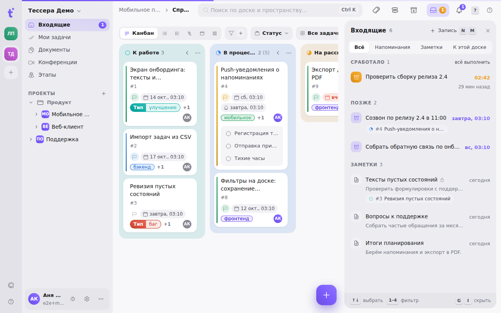
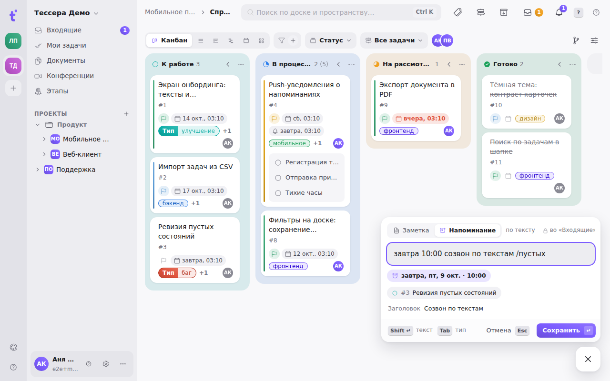

«Входящие» — ваши быстрые записи: заметки и напоминания в одной ленте. Записать можно откуда угодно, не уходя с доски, а лента открывается панелью справа и тоже не уводит с экрана. Отдельных разделов «Заметки» и «Напоминания» больше нет — старые адреса открывают эту панель.

Уведомления (упоминания, назначения, события GitLab) остаются под колокольчиком: во «Входящие» попадают только ваши записи.

## Записать

Кнопка **«＋»** в правом нижнем углу → **«Запись»**, или клавиши **N, затем M**. У кнопки открывается поле, которое читает строку на лету:

- есть дата или время — это **напоминание**: «завтра 10:00 позвонить в банк», «пт 18:30», «14.10», «через 2 ч». Дата без времени — 09:00, время, которое сегодня уже прошло, — завтра;
- нет — это **заметка**;
- `/2951` или `/слово из названия` — привязка к задаче. Под строкой появится чип задачи; если такой нет, чип станет красным и сохранить не получится.

Под строкой видно, что получилось: чип даты и времени, задача и заголовок. **Tab** переключает тип вручную (рядом появится «вручную ×»; дата у заметки зачёркивается и не применяется). **Shift+↵** раскрывает текст записи — тот же Markdown-редактор, что у описания задачи; **Ctrl+↵** сохраняет прямо из текста. **↵** — сохранить, **Esc** — закрыть, **↑** в пустом поле возвращает последнюю запись.

**N, затем R** открывает то же поле сразу с типом «Напоминание».

`#тег` и `@человек` строка уже понимает, но сохранять их в запись пока не умеет — это скоро.

## Лента

Панель открывается кнопкой с лотком в шапке (рядом с колокольчиком; число на ней — сработавшие напоминания), строкой **«Входящие»** в боковой панели или клавишами **G, затем I**. Повторное **G I** из ленты её скрывает. Ширину панели можно потянуть за левый край — она запомнится.

Сверху — фильтры: **Всё · Напоминания · Заметки · К этой доске** (последний — записи, привязанные к задачам открытой доски). Записи разложены по группам:

- **Сработало** — напоминания, время которых пришло; «всё выполнить» закрывает их разом;
- **Сегодня** — что ещё будет сегодня; выполненное сегодня остаётся здесь зачёркнутым до полуночи;
- **Позже**;
- **Заметки** — свежие сверху.

У отложенного напоминания рядом с задачей виден чип «с 12:00» — время, на которое оно было поставлено сначала.

## Клавиши в ленте

| Клавиша | Действие |
|---|---|
| ↑ ↓ | выбрать запись |
| 1–4 | фильтр |
| ↵ | открыть: заметка и напоминание без задачи правятся прямо в ленте, напоминание с задачей открывает задачу |
| E | выполнить напоминание (или вернуть) |
| H | отложить: через час, сегодня вечером, завтра утром, в понедельник, к сроку задачи или своя дата словами — «чт 15:30», «через 3 дня» |
| T | превратить в задачу — она появится в первой колонке открытой доски, текст записи станет описанием, время напоминания — сроком |
| Shift+D | превратить заметку в документ |
| L | привязать к задаче |
| ⌫ | удалить |

Выполнить, отложить и удалить срабатывают сразу, а внизу появляется сообщение с **«Отменить»** (или **Ctrl+Z**). Те же действия — в меню записи: кнопка «⋯» при наведении или правый клик.

## Кто видит запись

Напоминания — всегда только ваши. Заметки, сделанные через поле записи, тоже личные — у них замок. Заметки, написанные раньше в старом разделе «Заметки», остаются общими для пространства. Видимость своей заметки можно поменять в её меню: «Видна пространству».

Записи принадлежат пространству, в котором вы их сделали. Старые напоминания, не привязанные ни к задаче, ни к пространству, видны в ленте любого пространства.

## Записи в задаче

В окне задачи, между подзадачами и активностью, есть раздел **«Напоминания и заметки»** — ваши записи, привязанные к этой задаче.

- **«Напомнить»** (**Shift+R**) раскрывает быстрые варианты: **1** через час, **2** завтра утром, **3** к сроку задачи, **D** — дата словами.
- **«Заметка»** (**Shift+M**) открывает поле записи прямо в разделе, с задачей уже подставленной.

Клик по напоминанию — меню «Отложить», по заметке — правка её текста.

На карточке на доске ваше ближайшее напоминание по задаче видно колокольчиком со временем сразу после срока; сработавшее подсвечено оранжевым. Клик по нему — «Отложить». Коллеги видят на карточке только свои напоминания.

## «Мои задачи»

На стартовом экране справа — блок «Входящие»: сегодняшние напоминания и последние заметки. «Все N →» и **G I** открывают панель.

## Доставка

Сработавшее напоминание приходит так же, как раньше: push в мобильном приложении для Android и во внешние каналы, если они включены в [уведомлениях](/help/notifications). Отложенное сработает заново в новое время, выполненное больше не приходит.
