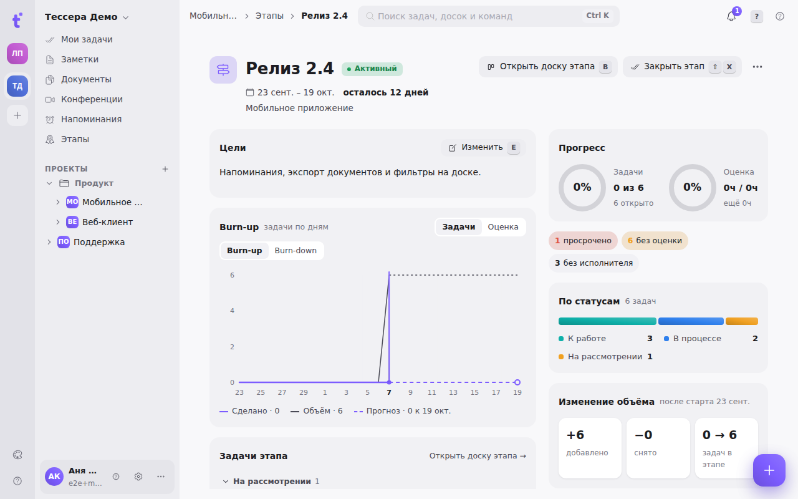
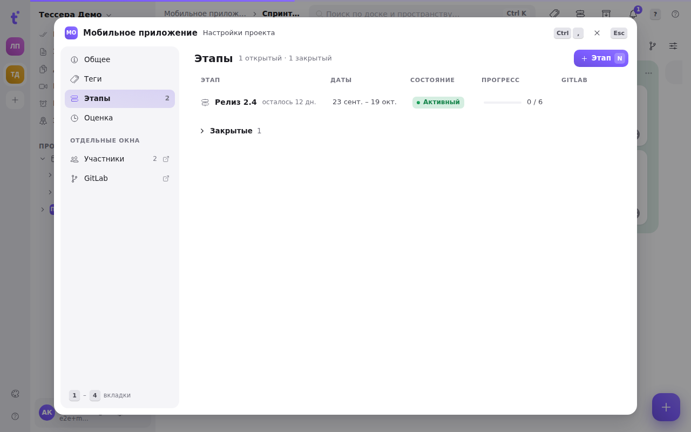
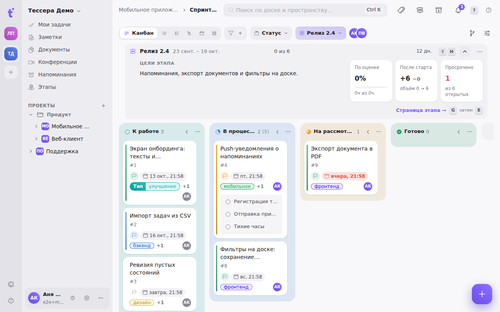

Этап (веха, спринт, milestone) — точка, к которой должен быть готов набор задач: релиз, демо, спринт, сдача заказчику. У каждого этапа есть цели, сроки, своя страница с метриками, а на доске — полоса с прогрессом.

## Где найти этапы

- **Раздел «Этапы»** в боковой панели — этапы всех проектов пространства сразу, с прогрессом. Переключатель **«Активные» / «Все»** добавляет закрытые. Клик по строке открывает страницу этапа, шестерёнка у проекта — его этапы в окне «Проект».
- **Дерево проектов.** Меню проекта → «Показывать в дереве» → «Этапы» или «Доски и этапы»: под проектом появятся его этапы с процентом готовности и строка **«Бэклог»** (задачи без этапа). Этап открывает свою страницу, «Бэклог» — доску проекта с этим фильтром. Закрытые скрыты, пока в том же меню не включить «Показывать закрытые этапы».
- **Окно «Проект» → «Этапы»** — управление этапами проекта (ниже).
- **Селектор этапа на доске** — фильтр доски по этапу (ниже).

## Состояния

Этапов хранится два состояния, как в GitLab: **активный** и **закрытый**. **«Запланирован»** — это активный этап, чьё начало ещё впереди; Tessera показывает его так сама, отдельно ничего ставить не нужно. У закрытого этапа запоминается дата закрытия.

## Управление этапами проекта

Вкладка **«Этапы»** [окна «Проект»](/help/project-window): строка этапа — название, «осталось N дн.», даты, состояние, прогресс «сделано / всего» и номер вехи в GitLab. Закрытые собраны в сворачиваемую группу внизу.

- **Создать** — кнопка **«+ Этап»** или **N**: пустая строка, имя, **Tab** — даты, **Enter** — создать (и сразу можно вводить следующий). Даты необязательны.
- **Открыть** — клик по строке или **Enter**: страница этапа.
- **Меню строки** («⋯» или **.**): переименовать (**F2**), даты, закрыть или открыть снова, создать веху в GitLab, удалить. Удаление — в два шага; задачи останутся, но потеряют этап.

## Страница этапа

Открывается из списка этапов, из дерева, по клику на имя в полосе этапа и клавишами **G**, затем **E** с доски, отфильтрованной по этапу.

- **Шапка**: имя, состояние, даты, сколько осталось, ссылка на веху в GitLab. Кнопки **«Открыть доску этапа»** (**B**) — доска, где лежит больше всего задач этапа, сразу с фильтром — и **«Закрыть этап»** (**Shift+X**, в два шага: первое нажатие спрашивает «Точно закрыть?»).
- **Цели** — описание этапа в Markdown. **«Изменить»** или **E** открывает редактор с упоминаниями через **@**; **Ctrl+Enter** сохраняет, **Esc** отменяет (если текст менялся — со вторым нажатием).
- **Burn-up** — линия «сделано» против линии объёма по дням этапа, пунктиром — прогноз до конца этапа по темпу последних пяти рабочих дней. Переключатели: **задачи / оценка**, **burn-up / burn-down**. Выходные подложены серым, сегодня — вертикальная отметка. До старта этапа графика нет.
- **Прогресс** — два кольца: по числу задач и по оценке.
- **Сигналы** — «просрочено», «без оценки», «без исполнителя»: клик фильтрует список задач ниже.
- **По статусам** — полоса из цветов колонок.
- **Изменение объёма** — сколько задач добавлено и снято после первого дня этапа и как изменился объём.
- **По исполнителям** — сделано / всего и оценка на человека.
- **Темп** — сколько сделано за этот этап против трёх прошлых закрытых, со средним и прогнозом.
- **Задачи этапа** — по статусам, незавершённые сверху; клик открывает задачу.

Объём и burn-up считаются по истории: каждое добавление задачи в этап и снятие с него записывается в историю задачи (вручную, синхронизацией GitLab или повтором задачи). Задачи, попавшие в этап до того, как Tessera стала это записывать, считаются в этапе со дня своего создания.

## На доске: селектор и полоса этапа

В подбаре доски, рядом с группировкой, — **селектор этапа** (**Shift+E**): «Этап: Спринт 42 ▬ 58 %». Меню: активные этапы с прогрессом, запланированные, **«Бэклог»** (**B**) — задачи без этапа, **«Все задачи»** (**A**) — без фильтра; закрытые — под «Показать закрытые». Сверху поиск; внизу «Управлять этапами…». Выбор запоминается на доску: вернувшись на неё, вы увидите тот же этап.

Когда выбран один этап, между подбаром и колонками появляется **полоса этапа**. Свёрнутая — одна строка: имя, даты, прогресс «18 из 31», первая строка целей и сколько дней осталось. **Shift+H** или шеврон разворачивает её: цели целиком и три цифры — прогресс по оценке, изменение объёма после старта, просроченные. Состояние полосы запоминается. В меню «⋯» — закрыть этап, открыть в GitLab, **скрыть полосу на этой доске** (вернуть — тем же **Shift+H**). Без целей полоса предлагает «Добавить цели →».

Новая задача, созданная на доске с фильтром по этапу, сразу получает этот этап.

## Как задача попадает в этап

Этап выбирается в окне задачи, в поле **«Этап»**; оттуда же его можно создать на ходу. Одна задача принадлежит одному этапу. На доске по этапам можно и **группировать** (колонки станут этапами, плюс «Без этапа») — подробнее в статье [Панель доски](/help/board-composer).

## Связь с GitLab

Если проект связан с GitLab, этап синхронизируется с вехой репозитория в обе стороны: имя, даты, состояние и описание (цели) приезжают из GitLab, а правка в Tessera уходит обратно. Собственный этап Tessera можно создать в GitLab пунктом меню «В GitLab».

**Правка и закрытие.** Цели («Изменить», **E**), даты, имя и «Закрыть этап» (**Shift+X** — на странице этапа, в полосе этапа и в строке окна «Проект») работают и для этапа из GitLab — изменение сразу записывается в веху GitLab. Для этого у привязки должна быть включена **обратная запись** ([GitLab: синхронизация](/help/admin-gitlab-sync)). Если она выключена, этап остаётся только для чтения: кнопки неактивны, подсказка на них объясняет почему — иначе следующая синхронизация молча вернула бы значения из GitLab.

**Если GitLab не принял запись** (сервер недоступен, нет прав), правка остаётся в Tessera, а этап помечается: в полосе этапа вместо строки целей — **«Описание не синхронизировано с GitLab · повторить»**, то же — в карточке целей на странице этапа и красным значком в окне «Проект». «Повторить» отправляет снова; следующая синхронизация повторяет запись и сама. Синхронизация такую правку не затирает.

**Если цели поменяли и в Tessera, и в GitLab** с последней синхронизации, запись не перетирает чужой текст: открывается окно [«Разрешение конфликтов»](/help/admin-gitlab-sync), где этап стоит в очереди рядом с задачами. Версия выбирается так же — «База», «Tessera» или «GitLab», либо объединение вручную (**M**); «Применить и отправить» сразу записывает решение в веху GitLab. Пока конфликт не решён, полоса этапа говорит «Конфликт с GitLab · разрешить».

Удаление связанного этапа предупреждает отдельно: **в GitLab веха останется**, снимется только связь. Как настраивается сама связь — в статье [GitLab: синхронизация](/help/admin-gitlab-sync).
