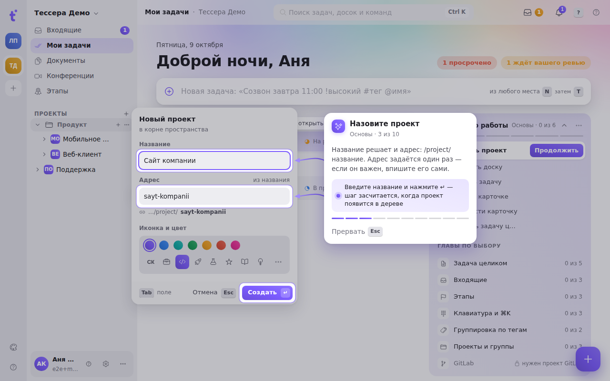
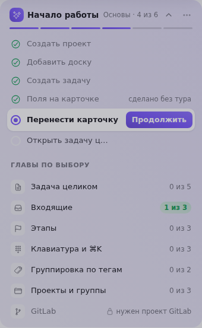
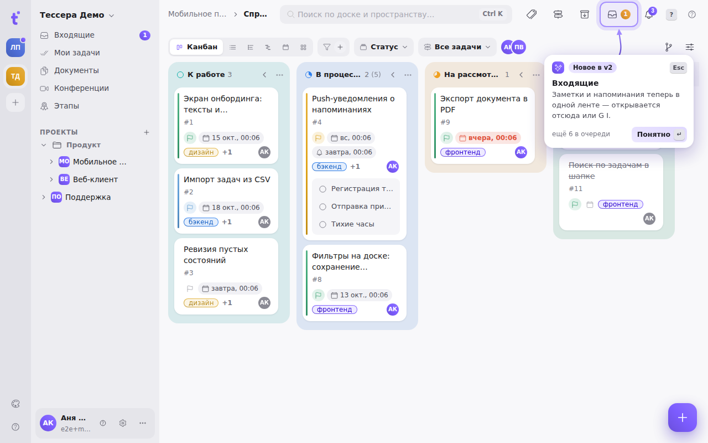
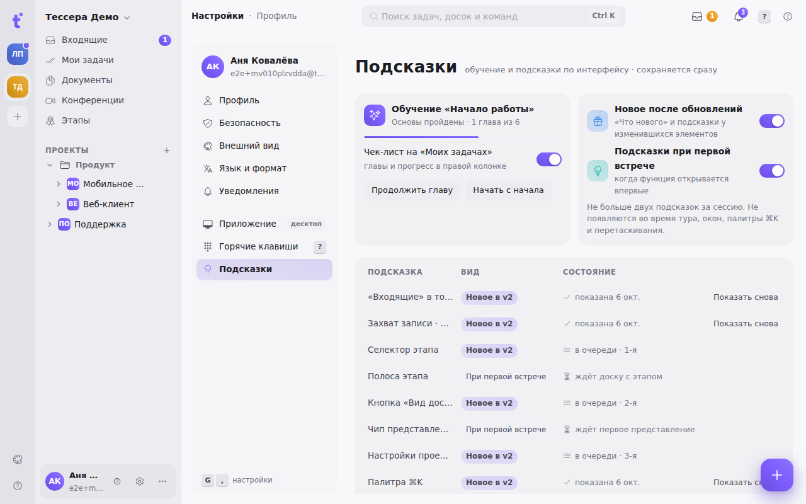

Tessera teaches itself right in the interface: the tour points at real buttons and counts real actions, the checklist on «My tasks» remembers what's already done, and short hints appear at new elements on their own.

## The «Get started» tour

The tour walks the live interface: the screen dims, the element in play stays in a bright window, an arrow reaches for it, and the step's card sits next to it. An info step is closed with **«Got it»** (<kbd>↵</kbd>); an action step counts itself once you actually did it: created a project, moved a card, opened a task. The plate on the step's card says what counts it. While a step is being counted, the card briefly says «Counted».

The tour is split into **chapters**. The required one is «Basics»: the space, a project, a board, a task, the fields on the card, moving it, the task window — ten steps. The rest are optional: «The whole task», «Inbox», «Stages», «Keyboard and ⌘K», «Grouping by tags», «Projects and groups» and «GitLab» (it opens once a GitLab project is connected to a board). Someone invited into a space that already has projects is greeted by a short «Welcome» chapter — with nothing to create.

The card's header shows the chapter and the step's number («Basics · 3 of 10»), and the chapter's steps are bars under the text.

- <kbd>←</kbd> **«Back»** returns to the previous info step of the same chapter. There's no way back through an action step — what was created stays.
- <kbd>Esc</kbd> asks **«Stop the tour?»**. «Continue later» puts the tour away while the progress stays in the checklist; «End the tour» switches it off for good — it won't open by itself again. A second <kbd>Esc</kbd> goes back to the step.
- If a step's element isn't on screen, the card waits for it at the edge of the screen and after a few seconds offers **«Skip the step»** with a countdown. A collapsed sidebar is expanded by the tour itself.

A new account gets «Basics» after the first sign-in. To take the tour again: **«?» → «Get started»** at the bottom of the space rail, the <kbd>Ctrl</kbd> <kbd>K</kbd> palette (the «Get started» command) or the checklist.

## The checklist on «My tasks»

The first card of the right column on «My tasks» is **«Get started»**. It lists results, not tour steps: «Create a project», «Add a board», «Create a task» and so on. A result is ticked even when you did it without the tour — then it says «done without the tour». A row starts its chapter from the step that counts it; **«Continue»** goes back to where you stopped.

Below are the optional chapters with their progress. The chevron folds the card into one line; the «⋯» menu has «Start over» and «Hide for good». Once everything is done, the card turns green.

## Hints

A hint is a small card with an arrow to an element, with no dimming. There are two kinds: **«New»** — at something that appeared or moved after an update, and **«Tip»** — at the first encounter with a feature, such as the stage strip on the first board with a stage, or undoing a delete.

Hints show one at a time, at most two a session, and stay out of the way of the tour, windows, the palette and dragging. A hint is closed by «Got it», <kbd>↵</kbd>, <kbd>Esc</kbd> or a click on the element itself — it won't come back. If its element isn't on screen right now, the hint waits without holding up the next one.

## «What's new» and «What changed»

After a Tessera update the **«What's new»** window tells what changed. Those who used the previous interface get, once, a card of the new interface with **«Show what changed»** — a six-step mini-tour of «Inbox», the stage on the board, the board view, the «Project» window and the palette. **«Later»** sends the same points to the hints. The whole changelog opens from the version number in the footer.

## Settings → «Hints»

Everything about the tour and hints is in **Settings → «Hints»**:

- the tour's progress, the checklist switch for «My tasks», «Continue the chapter» and «Start over»;
- switches for the kinds: «New after updates» (together with the «What's new» window) and «Hints at first encounter»;
- a table of hints with their state — shown, in the queue, waiting for its element — and **«Show again»** at each shown one;
- **«Show the hints again»** puts them all back into the queue.

## On a phone

On a phone the tour is a bottom sheet above the navigation: the step, «Back», «Got it» and «Stop», with the element highlighted on screen. If the sheet would cover the element, it moves to the top. To start the tour — «More» → «Get started». Hints on a phone are a card above the bottom navigation, closed with its button or a swipe down.
