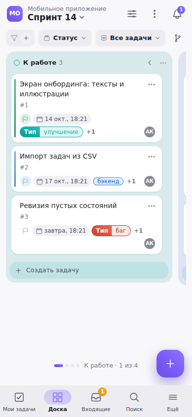
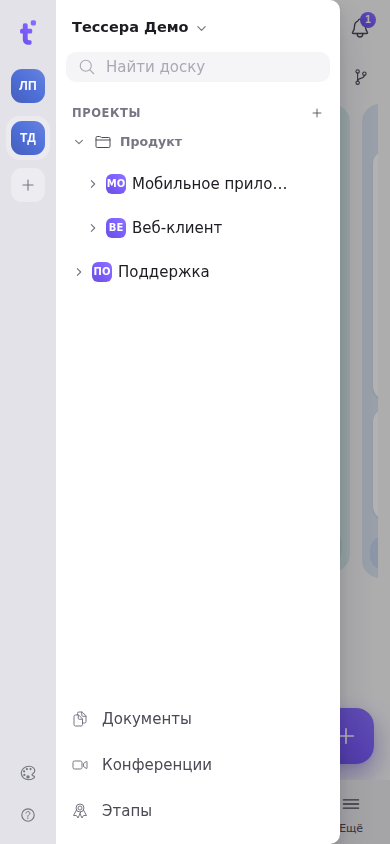
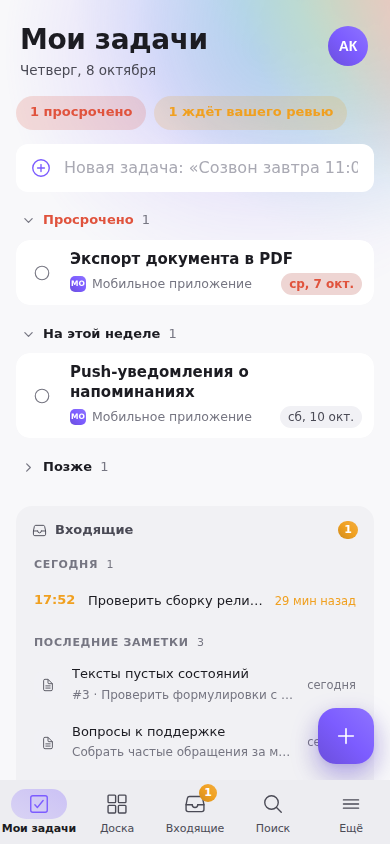
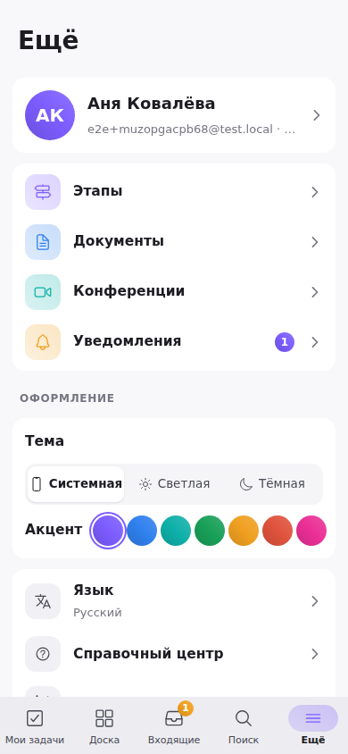

Tessera opens in a phone's browser as a full app: the same boards, tasks, Inbox and documents as on a computer, with the controls gathered in the bottom third of the screen — under your thumb.

## Bottom navigation

Five tabs sit at the bottom of the screen:

- **My tasks** — your open tasks by due date, a quick field for a new task and the Inbox block.
- **Board** — the board you had open last. Tap the tab once more while a board is open and the project tree opens.
- **Inbox** — notes and reminders; the badge counts the reminders that have gone off.
- **Search** — the same palette as ⌘K on a computer: tasks, boards and stages, people, commands. “Cancel” closes it.
- **More** — everything else: your profile, stages, documents, conferences, notifications, theme and accent, language, help, settings and signing out.

The system Back button works inside the app: it closes an open sheet, menu or the tree, and from a section's page it takes you back to where you came from.

## The project tree

There is no hamburger button: the project tree slides in from the left when you **tap the board's name** in the header or **swipe in from the left edge** of the screen. At the top are the workspaces (their tiles) and a “Find a board” field, below them groups, projects and boards, and at the bottom documents, conferences and stages. A long press on a row of the tree opens its menu.

## The board

Columns scroll sideways one at a time; under the board you can see which column you are on (“To do · 1 of 4”). On the right of the header are “Board view” (card size, fields, grouping, saved views — in a bottom sheet), the board menu (views: kanban, list, calendar, matrix, timeline, Gantt; tags, stages, archive) and the notification bell. A card keeps only its “⋯”: its menu has complete, priority, move to a column and the rest.

A task opens as a full-screen sheet. To close it, pull the sheet down by its handle or tap “×”.

## My tasks and the Inbox

On “My tasks” every task is a row of its own: a tap opens the task, the circle on the left completes it, and a **swipe to the left** shows “Done” (a long swipe completes it at once). Snoozing a task is not available yet — the button is visible but inactive.

In the Inbox a reminder swipes too: **right** to complete, **left** to snooze (the options come up in a bottom sheet). The “＋” button in the bottom-right corner creates a new record.

## Sheets instead of pop-ups

On a phone forms and menus open as a **bottom sheet**. A sheet opens halfway; pull it up by the handle and it takes the whole screen, pull it down and it folds back or closes. A sheet with a text field rises above the keyboard. Pop-ups and undoing a deletion show up above the bottom navigation one at a time: the rest wait their turn ("1 of 3"), a tap opens, a swipe down or aside dismisses, and the "+" button rises above them.

## More

The theme (system, light, dark) and the accent colour are switched here too. Notifications open as a screen of their own: the filters “All · Mentions · Assignments · GitLab”, “Mark all read” and a back arrow.
