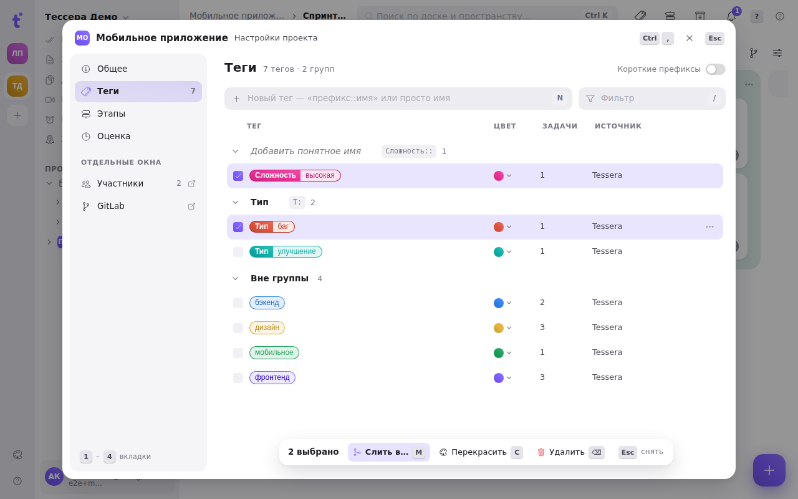

Тег в Tessera — не просто цветная метка. Колонки доски можно разложить **по тегам**, и тогда тег превращается в направление работы: команда, компонент, клиент, стадия проработки. Поэтому теги стоит заводить осознанно и называть по системе — на них держится второй взгляд на доску.

## Теги живут в проекте, а не в задаче

Набор тегов принадлежит **проекту**: все доски одного проекта видят один список, а соседний проект — свой собственный. Тег, снятый со всех задач, из списка не исчезает: он остаётся заготовкой, и колонка по нему на доске просто будет пустой.

## Где ими управлять

Теги проекта — вкладка **«Теги»** [окна «Проект»](/help/project-window). Открыть её можно кнопкой **«Теги»** в шапке доски, пунктом **«Управлять тегами…»** в выборе тегов у задачи или **Ctrl+,** и цифрой **2**. Это таблица: теги сгруппированы по префиксам, у каждого — цвет, сколько задач его носит и откуда он взялся (**Tessera** — заведён здесь, **Лейбл GitLab** — пришёл из синхронизации).

### Создать

Поле **«Новый тег»** над таблицей (клавиша **N**). Введите имя и нажмите **Enter**. Запись `префикс::имя` кладёт тег в группу этого префикса, а если такой группы нет — заводит её. Новый тег получает случайный цвет палитры. Имя, которое в проекте уже есть (без учёта регистра), не создаётся — поле так и скажет.

Рядом — **фильтр** (клавиша **/**): ищет по имени тега и по понятному имени его группы.

### Переименовать — кликом, без двойного

Клик по тегу в таблице, **Enter** или **F2** на строке превращают его в поле ввода. **Enter** или клик мимо сохраняют, **Esc** отменяет.

### Цвет

Кружок в колонке «Цвет» открывает палитру из семи цветов — клик применяет цвет сразу. Цвет — не только украшение: из него собираются градиент чипа на карточке, цвет колонки при группировке по тегам и заливка в фильтрах.

### Выбрать несколько: слить, перекрасить, удалить

Квадрат слева от тега (или **Пробел** на строке) выбирает её, **Shift+↑/↓** — диапазон. Внизу появляется панель действий:

- **«Слить в…»** (**M**) — для дублей вроде `design` / `дизайн` / `ui`. Окно предложит тег, в который сливать (по умолчанию — самый используемый), и после подтверждения все задачи остальных получат его, а остальные теги исчезнут. В истории задач слияние видно, как обычная правка тегов.
- **«Перекрасить»** (**C**) — один цвет на все выбранные.
- **«Удалить»** (**⌫**) — сразу, со всех задач проекта. Внизу экрана появится тост **«Отменить»** — 7 секунд, чтобы вернуть теги вместе с задачами, на которых они висели (или **Ctrl+Z**).

**Esc** снимает выбор. Те же действия по одному тегу — в меню «⋯» его строки.

## Префиксы: как из тегов получается система

Тег с двоеточием в имени Tessera читает как **префикс и значение**:

- `Сложность::высокая` — разделитель `::`;
- `Статус: в ревью` — разделитель `: ` (двоеточие с пробелом).

Обе записи равноправны. Всё, что до разделителя, — **префикс** (пространство имён), всё после — значение.

Что это даёт:

1. **Двухсегментный чип.** Такой тег рисуется как в GitLab: слева залитый сегмент с именем префикса, справа — значение. Один взгляд на карточку, и понятно, что «высокая» — это про сложность, а не про приоритет.
2. **Группировку списков.** В поповере тегов, в выборе тегов у задачи и в фильтре доски теги собираются в группы по префиксу, с заголовком у каждой. Список из сорока тегов остаётся читаемым.
3. **Колонки по одному префиксу.** На доске можно сгруппировать не «по всем тегам», а **по конкретному префиксу** — тогда колонками станут только его значения, а остальные теги в раскладке не участвуют. Подробнее — [Панель доски](/help/board-composer).

Регистр и пробелы вокруг префикса не важны: `Сложность::` и `сложность ::` — один и тот же префикс.

## Имена префиксов

Префикс в имени тега бывает коротким — `T: bug`, `S: doing`. Читать такое на карточке неудобно, поэтому у группы в таблице есть **понятное имя**: клик по заголовку группы (или **F2** на нём) открывает поле прямо в заголовке. Написали у `T:` имя «Тип» — и во всех чипах, заголовках групп и фильтрах вместо `T` появится «Тип». Сохраняется по **Enter** или клику мимо, пустое поле снимает имя — префикс снова показывается как есть. Сырой префикс всегда виден рядом серой плашкой.

Имена префиксов — настройка **проекта**: их видят все участники. Правка одной группы не трогает имена остальных.

## Короткие префиксы — переключатель для себя

Справа в заголовке вкладки «Теги» — переключатель **«Короткие префиксы»**. Он делает обратное: показывает сырой префикс (`T`) вместо понятного имени («Тип»). Это личная настройка **этого устройства** — она не меняется у коллег и не переезжает на телефон. Полезно, когда чипов на карточке много и место дороже слов.

## Теги на задаче

В окне задачи и в быстром меню карточки теги выбираются из того же списка, сгруппированного по префиксам: клик по тегу вешает его, повторный — снимает.

**Главная спотыкалка при переходе из ClickUp — создание тега прямо отсюда.** Внизу выбора есть поле, подписанное «Новый тег, Enter», и подпись не преувеличивает: **кнопки рядом с ним нет, тег создаётся только по Enter**. Введённое и не подтверждённое имя не сохранится, а поповер закроется как ни в чём не бывало. Созданный так тег сразу вешается на задачу и получает случайный цвет из палитры — если цвет важен, поправьте его в таблице тегов: пункт **«Управлять тегами…»** под выбором открывает её с фильтром по набранному.

Одна задача может нести сколько угодно тегов. При группировке доски по тегам она покажется **в каждой соответствующей колонке** — это одна и та же карточка, а не копии.

## Теги и GitLab

На доске, связанной с GitLab, метки приезжают из репозитория тегами — в таблице у них источник «Лейбл GitLab». Часть из них разбирается правилами в поля задачи: метка `S: done` может означать колонку, `P: high` — приоритет. Такие теги **не предлагаются в выборе у задачи**: повесить их вручную значило бы разойтись с полем, которым они управляют.

Теги, чей префикс подпадает под правило GitLab, в таблице **с замком**: их нельзя выбрать, переименовать или перекрасить — имя и цвет приходят из GitLab, и следующая синхронизация вернула бы своё. Подсказка на теге говорит, из какого репозитория правило.

Как настраиваются сами правила разбора — в статье [GitLab: синхронизация](/help/admin-gitlab-sync).
