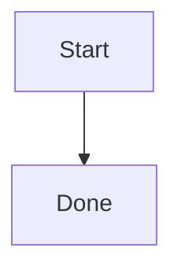

A task description, a comment, a note and the text in a document are all edited by the same editor. It stores **Markdown** — not a house format and not HTML — so the text survives being copied into any other tool.


## The toolbar

Buttons apply to the selected text; with nothing selected they insert a stub and put the caret where you have to type.

| Button | What it inserts |
|---|---|
| **B** | `**bold**` |
| *I* | `*italic*` |
| ~~S~~ | `~~strikethrough~~` |
| `</>` | `` `code` `` |
| Link | `[text](address)` |
| Heading | `## ` at the start of the line |
| Bullet list | `- ` at the start of the line |
| Numbered list | `1. ` at the start of the line |
| Checkbox | `- [ ] ` at the start of the line |
| Quote | `> ` at the start of the line |
| Spoiler | a `<details>` block — collapsed text under a caption |

You don't have to look at the toolbar at all: **select some text and a compact bar floats above the selection** with the same bold, italic, strikethrough, code and link.

## Formatting keys

| Key | Action |
|---|---|
| **Ctrl+B** | bold |
| **Ctrl+I** | italic |
| **Ctrl+Shift+X** | strikethrough |
| **Ctrl+E** | code |
| **Ctrl+Shift+K** | link (**Ctrl+K** belongs to the command palette) |
| **Ctrl+Shift+7** | numbered list |
| **Ctrl+Shift+8** | bulleted list |
| **Ctrl+Enter** | send a comment or save the description |

On a Mac it is **⌘** instead of Ctrl. Pressing a key again takes the mark off: **Ctrl+B** over bold text makes it plain. The selection bubble's buttons name their keys in their tooltips.

While you type, the markup is tinted right in the field: the `##`, `**`, `` ` ``, `- [ ]` markers are faded, headings stand out, and mentions and task links take the accent colour.

## The @, # and / lists

- **`@`** — people. Those already in the task come first: assignees, the author, whoever wrote in the thread; then the rest of the workspace and the GitLab logins.
- **`#`** — tasks of the whole workspace, by number or by words of the title. Each row shows the project and the stage (or the board).
- **`/`** — commands, at the start of a line and in comments only, grouped into Fields, Status, Links, Subtasks and Custom.

**↑ ↓** pick a row, **Enter** or **Tab** inserts it, **Esc** closes the list and leaves what you typed as it is. When nothing matches, the list says so — e.g. «Nobody — «@olya» stays as text».

## Quote in reply

Select a stretch of the description or of someone's comment and **«Quote in reply»** and «Link to the fragment» appear over it. Quoting (or **Q** while the bubble is up) adds the selection to the new comment as `> …` lines and puts the cursor there. «Link to the fragment» is not built yet — it is a «Soon» stub.

## Checkboxes work in finished text

A `- [ ]` checkbox isn't just a glyph. In a rendered description or comment you **can click it**, and the change is written back into the Markdown itself: `- [ ]` becomes `- [x]`. That turns a description into a live checklist you don't have to create subtasks for.

## Images: the button, the clipboard and drag-and-drop

An image gets into the text three ways, all of them equal:

1. **The image button** in the toolbar — opens a file picker.
2. **Ctrl+V** — paste an image straight from the clipboard (no need to save a screenshot to disk first).
3. **Dropping a file** onto the input.

The editor uploads the file and inserts `` in its place. PNG, JPEG, GIF, WebP and BMP are accepted. **SVG is deliberately refused**: such a file would run as active content on our own origin.

## Task attachments: the paperclip

The paperclip only appears where the text belongs to a task. It does two things:

- **uploads a file** into that task's “Files” tab and immediately inserts a download link into the text;
- **lists the files already attached**, so you can point at an existing one without uploading anything again.

Hence the drag-and-drop rule: **an image becomes an image in the text, any other file becomes a task attachment** with a link to it. There is no need to visit the “Files” tab separately.

## Mermaid diagrams

The graph-node button inserts a stub:

````

````

In the preview and in the finished description that block is drawn as a diagram. Inside it, ordinary [Mermaid](https://mermaid.js.org/) syntax applies: `flowchart`, `sequenceDiagram`, `gantt`, `stateDiagram` and the rest.

If a diagram stayed text instead of being drawn, Mermaid could not parse it. Check the indentation and the arrows: the block is either drawn whole or not at all.

## Code highlighting

Fences with a language are highlighted: JavaScript, TypeScript, JSON, YAML, Python, Bash, Go, SQL, XML/HTML, CSS, Markdown, Dockerfile, INI.

````
```go
func main() { fmt.Println("hello") }
```
````

Inside code **nothing is substituted**: `#2550` in a code sample doesn't become a task link, and `@root` in a shell snippet doesn't become a mention. The same goes for commands: `/close` inside a code block is not executed, so command examples are safe to write out.

## Preview and full screen

The **«Write · Preview»** switch over the field shows exactly what everyone else will see.

The button with the outward arrows (**«Full screen»** — in the comment's «Aa» row and in the description's bar) opens the **fullscreen editor**, a large window over the task. It has three modes: **«Write»** (**Ctrl+1**), **«Side by side»** (**Ctrl+2**, the default: the text on the left, a live preview with scrolling in sync on the right) and **«Preview»** (**Ctrl+3**). The footer tells when the text was last saved. **Esc** folds the window back into the field and keeps the text; **Ctrl+Enter** or «Done» does what it does in the field: the description saves, the comment is sent. The @ # / lists and the selection bubble work inside. On a phone the window takes the whole screen and opens on «Write».

## Mentions and task links

`@` opens the list of members, and `#123` in finished text becomes a link to a task — see [Comments](/help/comments) for the details.

One difference is worth keeping in mind: **only a comment sends a mention notification**. In a task description `@Name` will be highlighted and will resolve to the person, but no mail and no bell reaches them — a description is edited many times over, and notifying on every save would be noise. To call a colleague in, write a comment.

## What the editor saves, and when

The description opens for editing with a click on the text, the **«Edit»** button in its corner or the **I** key (the old **Shift+E** still works). Under it are **«Cancel Esc»** and **«Save Ctrl+Enter»**. If something has been typed, **Esc** first asks **«Discard changes?»**: **Enter** discards, another **Esc** keeps editing. The draft is still saved whenever the focus leaves the field. If the description was changed in GitLab meanwhile, the conflicts window opens.

A comment is sent with the button or with **Ctrl+Enter**.
