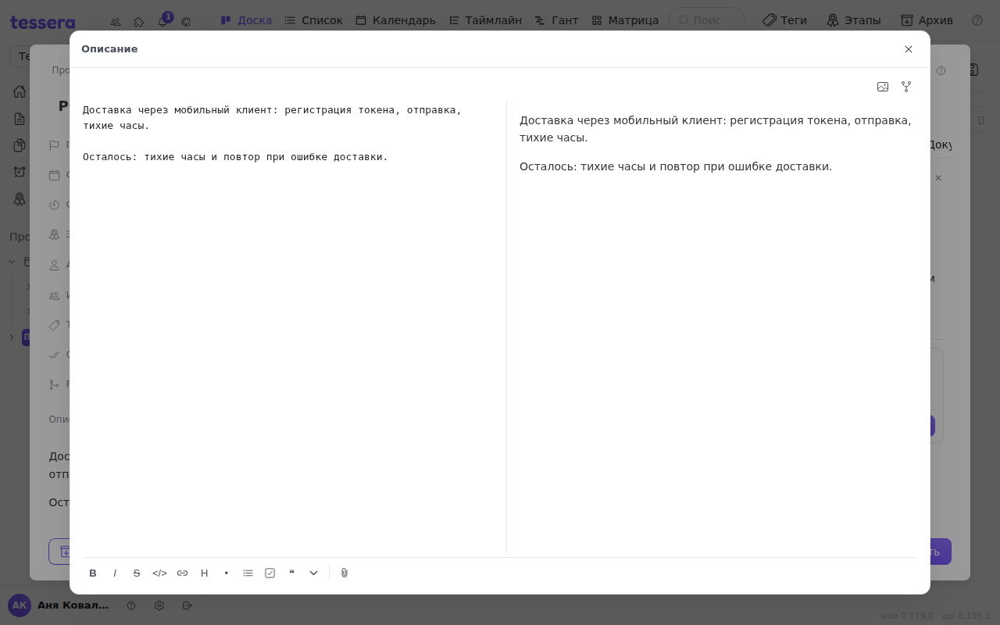
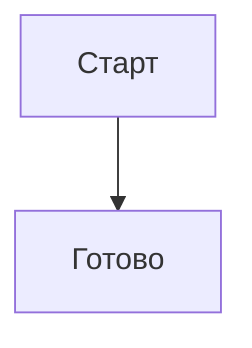

Описание задачи, комментарий, заметка и текст в документе редактируются одним и тем же редактором. Он хранит **Markdown** — не «свою» разметку и не HTML, поэтому текст переживает копирование в любой другой инструмент.



## Тулбар

Кнопки применяются к выделенному тексту, а если ничего не выделено — вставляют заготовку и ставят курсор туда, где нужно писать.

| Кнопка | Что вставляет |
|---|---|
| **Ж** | `**жирный**` |
| *К* | `*курсив*` |
| ~~З~~ | `~~зачёркнутый~~` |
| `</>` | `` `код` `` |
| Ссылка | `[текст](адрес)` |
| Заголовок | `## ` в начало строки |
| Маркированный список | `- ` в начало строки |
| Нумерованный список | `1. ` в начало строки |
| Чекбокс | `- [ ] ` в начало строки |
| Цитата | `> ` в начало строки |
| Спойлер | блок `<details>` — свёрнутый текст с подписью «Подробнее» |

Форматирование можно применить и не глядя на тулбар: **выделите текст — и через мгновение над выделением всплывёт компактная панель** с теми же жирным, курсивом, зачёркиванием, кодом и ссылкой. Подсказка у каждой кнопки называет её клавишу.

## Клавиши форматирования

| Клавиша | Действие |
|---|---|
| **Ctrl+B** | жирный |
| **Ctrl+I** | курсив |
| **Ctrl+Shift+X** | зачёркнутый |
| **Ctrl+E** | код |
| **Ctrl+Shift+K** | ссылка (**Ctrl+K** занят палитрой команд) |
| **Ctrl+Shift+7** | нумерованный список |
| **Ctrl+Shift+8** | маркированный список |
| **Ctrl+Enter** | отправить комментарий или сохранить описание |

На Mac вместо Ctrl — **⌘**. Повторное нажатие снимает пометку: **Ctrl+B** по уже жирному тексту делает его обычным.

Пока вы пишете, разметка подсвечивается прямо в поле: значки `##`, `**`, `` ` ``, `- [ ]` приглушены, заголовки выделены, а упоминания и ссылки на задачи окрашены акцентом.

## Списки @, # и /

- **`@`** — люди. Первыми идут те, кто уже в задаче: исполнители, автор, участники обсуждения; ниже — остальные участники пространства и логины GitLab.
- **`#`** — задачи всего пространства: по номеру или по словам из названия. В строке видно проект и этап (или доску).
- **`/`** — команды, только в начале строки и только в комментарии; список разбит на группы «Поля», «Статус», «Связи», «Подзадачи» и «Свои».

**↑ ↓** выбирают строку, **Enter** или **Tab** вставляют её, **Esc** закрывает список и оставляет набранный текст как есть. Если ничего не нашлось, список так и скажет — например, «Никого — «@оля» останется текстом».

## Цитата в ответ

Выделите кусок описания или чужого комментария — над ним появятся **«Цитировать в ответ»** и «Ссылка на фрагмент». Цитата (или клавиша **Q**, пока панель на экране) добавит выделенное в поле нового комментария строками `> …` и поставит туда курсор. «Ссылка на фрагмент» пока не работает — это заглушка «Скоро».

## Чекбоксы работают в готовом тексте

Чекбокс `- [ ]` — не просто значок. В отрендеренном описании или комментарии по нему **можно кликнуть**, и правка запишется в сам Markdown: `- [ ]` станет `- [x]`. Так из описания получается живой чек-лист, для которого не нужно заводить подзадачи.

## Картинки: кнопка, буфер обмена и перетаскивание

Изображение попадает в текст тремя способами, и все три равноправны:

1. **Кнопка с картинкой** в тулбаре — открывает выбор файла.
2. **Ctrl+V** — вставка картинки прямо из буфера обмена (скриншот не нужно сохранять на диск).
3. **Перетаскивание файла** в поле ввода.

Редактор загружает файл и вставляет на его место ``. Принимаются PNG, JPEG, GIF, WebP и BMP. **SVG сознательно не принимается**: такой файл исполнялся бы как активное содержимое на нашем же домене.

## Вложения задачи: скрепка

Скрепка появляется в тулбаре только там, где текст принадлежит задаче. Она делает две вещи:

- **загружает файл** во вкладку «Файлы» этой задачи и сразу вставляет в текст ссылку на скачивание;
- **показывает уже приложенные файлы**, чтобы сослаться на существующий, ничего не загружая заново.

Отсюда же правило перетаскивания: **картинка становится картинкой в тексте, а любой другой файл — вложением задачи** со ссылкой на него. Отдельно ходить на вкладку «Файлы» не нужно.

## Диаграммы Mermaid

Кнопка с узлами графа вставляет заготовку:

````

````

В предпросмотре и в готовом описании этот блок рисуется как диаграмма. Внутри работает обычный синтаксис [Mermaid](https://mermaid.js.org/): `flowchart`, `sequenceDiagram`, `gantt`, `stateDiagram` и остальные.

Если диаграмма не нарисовалась, а осталась текстом — значит Mermaid не смог разобрать её синтаксис. Проверьте отступы и стрелки: блок рисуется целиком или не рисуется вовсе.

## Подсветка кода

Фенсы с указанием языка подсвечиваются: JavaScript, TypeScript, JSON, YAML, Python, Bash, Go, SQL, XML/HTML, CSS, Markdown, Dockerfile, INI.

````
```go
func main() { fmt.Println("привет") }
```
````

Внутри кода **ничего не подменяется**: `#2550` в примере кода не станет ссылкой на задачу, а `@root` в команде оболочки — упоминанием. Это касается и команд: `/close` внутри блока кода не выполнится, поэтому примеры команд можно спокойно приводить в тексте.

## Предпросмотр и полный экран

Переключатель **«Написать · Просмотр»** над полем показывает ровно то, что увидят остальные.

Кнопка с расходящимися стрелками (**«На весь экран»** — в строке «Aa» комментария и в панели описания) открывает **полноэкранный редактор** — крупное окно поверх задачи. У него три режима: **«Написать»** (**Ctrl+1**), **«Рядом»** (**Ctrl+2**, по умолчанию: слева текст, справа живой предпросмотр с синхронной прокруткой) и **«Просмотр»** (**Ctrl+3**). Внизу видно, когда текст последний раз сохранился. **Esc** сворачивает окно обратно в поле — текст остаётся; **Ctrl+Enter** или «Готово» — то же, что в самом поле: описание сохраняется, комментарий отправляется. Внутри работают и `@ # /`, и панель над выделением. На телефоне окно занимает весь экран и открывается в режиме «Написать».

## Упоминания и ссылки на задачи

`@` открывает список участников, `#123` в готовом тексте превращается в ссылку на задачу — подробнее об этом в статье про [комментарии](/help/comments).

Одну разницу стоит держать в голове: **уведомление об упоминании отправляет только комментарий**. В описании задачи `@Имя` подсветится и будет ссылаться на человека, но письма и колокольчика он не получит — описание правится помногу раз, и уведомлять на каждое сохранение было бы шумом. Хотите позвать коллегу — напишите комментарий.

## Что редактор сохраняет и когда

Описание открывается в правку щелчком по тексту, кнопкой **«Изменить»** в его углу или клавишей **I** (старая **Shift+E** тоже работает). Внизу — **«Отмена Esc»** и **«Сохранить Ctrl+Enter»**. Если что-то уже набрано, **Esc** сначала спросит **«Отменить правки?»**: **Enter** отменяет, ещё один **Esc** — продолжить правку. Черновик при этом по-прежнему сохраняется, когда вы уводите из поля фокус. Если описание тем временем поменяли в GitLab, откроется окно конфликтов.

Комментарий отправляется кнопкой или **Ctrl+Enter**.
